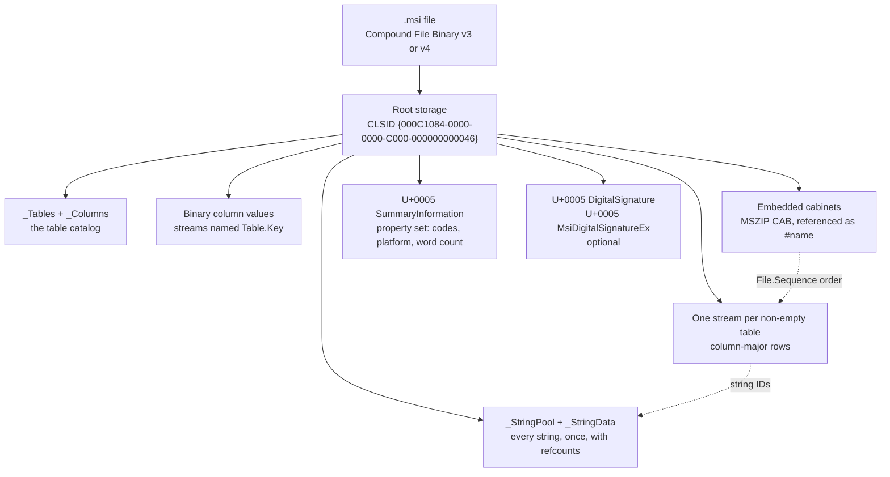

# Windows Installer format and interoperability specification

This document describes Windows Installer package formats, on-disk structures, database semantics, engine behavior and interoperability. Microsoft specifications, native Windows behavior, WiX observations and GNOME msitools observations are treated as separate kinds of evidence. The full
specification has 13 chapters, a test-vector appendix and machine-readable
schemas for the 97 standard tables and the UI tables. References such as
"ch. 05 §4" point into it.

As of 2026-10-25.

## Contents

- [Purpose and scope](#purpose-and-scope)
- [1. MSI package structure](#1-msi-package-structure)
- [2. Container: Compound File Binary](#2-container-compound-file-binary)
- [3. Database storage](#3-database-storage)
- [4. Summary information](#4-summary-information)
- [5. Cabinets](#5-cabinets)
- [6. Database schema](#6-database-schema)
- [7. User interface](#7-user-interface)
- [8. Installer runtime](#8-installer-runtime)
- [9. Actions and sequences](#9-actions-and-sequences)
- [10. WiX v3 authoring model](#10-wix-v3-authoring-model)
- [11. WiX v3 build semantics](#11-wix-v3-build-semantics)
- [12. Digital signatures](#12-digital-signatures)
- [13. WiX v4 and later](#13-wix-v4-and-later)
- [14. Conformance and verification](#14-conformance-and-verification)
- [15. Test vectors and verification](#15-test-vectors-and-verification)
- [16. Independent implementation comparison](#16-independent-implementation-comparison)
- [17. The engine without custom-action code](#17-the-engine-without-custom-action-code)
- [18. Reference chapters](#18-reference-chapters)
- [Appendix B. Pitfalls and checks](#appendix-b-pitfalls-and-checks)

## Purpose and scope

This is a language- and tool-independent reference for reading, writing, validating and installing MSI packages. It does not prescribe an implementation, CLI, authoring syntax or compression library.

| Topic | Scope |
| --- | --- |
| Format | Compound File Binary, MSI relational storage, summary information, cabinets, tables and streams |
| Behavior | Windows Installer properties, actions, components, upgrades, UI and validation |
| Related formats | MSI, MSM, MST, MSP and PCP differences where supported by evidence |
| Interoperability | Native Windows Installer, WiX and GNOME msitools behavior |

### Evidence terminology

- **Normative:** grounded in a named Microsoft specification or documented Windows Installer API contract.
- **Observed (Windows):** reproduced with the native Windows Installer API, installer runtime or analyzed binary behavior.
- **Observed (WiX / msitools):** reproduced for a named version of that producer or reader; not a universal MSI requirement.
- **Reported:** described in a third-party issue, log or commit but not independently reproduced.
- **Unverified:** needs a repeatable native compatibility test.
- **Recommended:** an optional interoperable or deterministic output profile, not a Windows Installer mandate.
- **Source (WiX / msitools):** read in that producer's source code at a pinned commit (section 17.6); describes the producer and the engine facts its authors relied on, not a universal requirement.

MUST, SHOULD and MAY use RFC 2119 terminology only within the declared scope of a rule. Successful parsing, successful native API opening and successful installation are distinct conformance levels. A reference writer's deterministic bytes do not define the only valid encoding.

### Sources and limitations

- [Microsoft Windows Installer](https://learn.microsoft.com/en-us/windows/win32/msi/windows-installer-portal), [MS-CFB](https://learn.microsoft.com/en-us/openspecs/windows_protocols/ms-cfb/) and [MS-OLEPS](https://learn.microsoft.com/en-us/openspecs/windows_protocols/ms-oleps/).
- [GNOME msitools](https://github.com/GNOME/msitools): portable MSI database reading/writing through libmsi, based on a subset of Wine's implementation.
- [WiX Toolset](https://github.com/wixtoolset/wix): producer-specific MSI authoring, binding, validation and native MSI database interoperability.
- Source reading: WiX at commit 53215fc (2026-10-24, MS-RL) and msitools at 8deb133 (2026-10-24, LGPL-2.1 / GPL-2.0) were read for behaviour, not copied; section 17.6 lists the files and such statements carry **(source)**.
- Native Windows msi.dll, msiexec.exe and cabinet.dll: investigation targets; identifying exports does not prove internal algorithms.

Earlier reference hashes and toolchain output comparisons are retained as historical evidence, but should not be promoted to universal requirements without identifying sample hashes, versions and reproduction steps.
## 1. MSI package structure

An `.msi` file is a relational database stored as streams inside a Microsoft
Compound File, with the payload in embedded cabinets.



| Layer | What it holds | Section |
| --- | --- | --- |
| Container | Sectors, FAT, directory tree of named streams | 2 |
| Storage | Encoded stream names, string pool, catalog, table streams | 3 |
| Summary information | Package code, platform, languages, source flags | 4 |
| Payload | Cabinets with the files in `File.Sequence` order | 5 |
| Schema | What each table and column means | 6, 7 |
| Runtime | What the installer does with the tables | 8, 9 |
| Toolchain model | What WiX writes for each concept | 10, 11, 13 |
| Signing | Authenticode over the streams | 12 |

## 2. Container: Compound File Binary

Every `.msi`, `.msm`, `.mst`, `.msp` and `.pcp` file is a Compound File Binary (CFB) file, written here with every free choice fixed.

### Layout

| Offset | Header field (512 bytes) | Writer value |
|---|---|---|
| 0x00 / 0x08 | Signature / header CLSID (16 bytes) | `D0 CF 11 E0 A1 B1 1A E1` / zero |
| 0x18 / 0x1A / 0x1C | Minor version / major version / byte order | 0x003E / 3 or 4 / 0xFFFE |
| 0x1E / 0x20 / 0x22 | Sector shift / mini sector shift / reserved (6 bytes) | 9 or 12 / 6 / zero |
| 0x28 / 0x2C / 0x30 | Directory sector count / FAT sector count / first directory sector | 0 in v3, D in v4 / F (D, F: writer steps below) / sector |
| 0x34 / 0x38 | Transaction signature / mini stream cutoff | 0 / 4096 |
| 0x3C / 0x40 / 0x44 / 0x48 | First MiniFAT sector / count / first DIFAT sector / count | ENDOFCHAIN and 0 when absent |
| 0x4C | DIFAT[0..108] (436 bytes) | first 109 FAT sector numbers, rest FREESECT |

- Sector *n* starts at `(n + 1) × SS`. Version 3 uses SS = 512. Version 4 uses SS = 4096 and zero-fills header bytes 512–4095.
- Special values: MAXREGSECT 0xFFFFFFFA (never used), DIFSECT 0xFFFFFFFC, FATSECT 0xFFFFFFFD, ENDOFCHAIN 0xFFFFFFFE, FREESECT and NOSTREAM 0xFFFFFFFF.
- FAT: one u32 per sector, SS/4 per FAT sector; entries past end of file are FREESECT. DIFAT: FAT sector numbers in order, 109 in the header, then SS/4 − 1 per DIFAT sector plus a link.
- Mini stream: the root entry's chain, cut into 64-byte mini sectors chained by the MiniFAT. It holds every stream under 4096 bytes. Root size is `(highest mini sector + 1) × 64`.

| Offset | Directory entry field (128 bytes) | Rule |
|---|---|---|
| 0x00 / 0x40 | Name (64 bytes) / name length | UTF-16LE + U+0000, zero-filled / bytes incl. terminator |
| 0x42 / 0x43 | Object type / colour | 0 unused, 1 storage, 2 stream, 5 root / 0 red, 1 black |
| 0x44 / 0x48 / 0x4C | Left sibling / right sibling / child | SID or NOSTREAM |
| 0x50 / 0x60 / 0x64 / 0x6C | CLSID / state bits / creation time / modified time | CLSID on storages and root only; everything else 0 |
| 0x74 / 0x78 | Starting sector / size (u64) | sector or mini sector, ENDOFCHAIN if empty, 0 for storages / v3: upper 32 bits 0 |

A sector holds 4 entries in v3 and 32 in v4. Entry 0 is the root: `Root Entry` (length 0x16), no siblings, SHOULD be black. Unused entries are zero except the three links (NOSTREAM); they fill the last directory sector.

### Names, trees and writer

- Names are 1–31 UTF-16 units as stored, without `/ \ : !` or U+0000. Siblings MUST be unique ignoring case.
- `Compare`: the shorter name is smaller; at equal length, compare `Upper(unit)` as unsigned u16. `Upper` is Unicode 5.0 simple uppercase plus Vista overrides (chapter 01 §9.2).
- A writer with ASCII-only `Upper` MUST reject names with other cased units. MSI names (ASCII, U+3800–U+4840, U+0005) never need more.
- Root CLSID for `.msi`, `.msm` and `.pcp`: `{000C1084-0000-0000-C000-000000000046}`, stored `84 10 0C 00 00 00 00 00 C0 00 00 00 00 00 00 46`. `.mst` uses `{000C1082-…}` and `.msp` `{000C1086-…}`. Sub-storages carry their content's CLSID.

Writer tree strategy (SHOULD; a valid red-black tree that reproduces the test vector):

1. Sort the n children ascending by `Compare`.
2. Make `A[floor(n/2)]` the top node; build the left and right subtrees from the lower and upper halves, recursively.
3. With `F = floor(log2(n + 1))`, colour nodes at depth `< F` black and deeper nodes red.

All-black trees are also valid. SIDs: root 0, then depth-first pre-order with children in `Compare` order, unused entries last. Writer steps:

1. Validate names and limits. Assign SIDs; use `D = ceil(E / (SS/128))` directory sectors for E entries.
2. Build the trees. A size-0 stream gets no sectors (start ENDOFCHAIN); under 4096 bytes is small; the rest is large.
3. Pack small streams in SID order into `ceil(size/64)` mini sectors each. `M = ceil(nMini / (SS/4))`, `S = ceil(nMini × 64 / SS)`, `L = Σ ceil(size / SS)` over large streams.
4. From F = X = 0, repeat to a fixed point: `T = F + X + D + M + S + L` (+1 for a v4 range-lock sector), `F = ceil(T / (SS/4))`, `X = F ≤ 109 ? 0 : ceil((F − 109) / (SS/4 − 1))`.
5. Order sectors: FAT, DIFAT, directory, MiniFAT, mini stream, then large streams contiguously in SID order. Zero-pad every sector and zero all timestamps and state bits; the file is `(T + 1) × SS` bytes.

- Writers SHOULD write v3 and MUST fail above 0x7FFFFE00 bytes. A v4 file above 0x7FFFFF00 bytes MUST reserve sector 0x7FFFE as an ENDOFCHAIN range-lock sector.
- Readers MUST accept both versions; two large packages written by the native engine were v4 (observed). They MUST reject a bad signature, byte order, or (major, shift) other than (3, 9) and (4, 12).
- Readers SHOULD look names up in a map from a full in-order walk, not by tree search. They ignore colours, keep visited sets, and never allocate from unchecked sizes.
- Readers MUST treat a size-0 stream as empty whatever its starting sector, without following a chain. Other writers emit 0-byte `_StringData` and `_Tables` streams with a mini-stream start sector, and one CFB library has failed to open them (reported).
- Every directory entry the walk finds MUST be readable by name. One reader dropped embedded cabinets of current Windows SDK packages because it opened streams by index (reported).

Test vector (chapter 01 §15): `.msi` root, `Small` (`0123456789` × 10) and `Large` (5000 bytes, byte i = i mod 256). `Small` is the black top node; `Large` is its red left child. v3: 7680 bytes, SHA-256 `37d8668bf78bc6da2c9b3c6fa3da9c0ffb6824baee21bf13ff9b02dd74e08aed`. v4: 28672 bytes, SHA-256 `acb3c3db476f1d8aebfac49e89b86895756faa24288228a61f617d3c4d54956a`.

Unverified:

- The start sector Windows writes for empty streams; its uppercase table beyond the documented overrides; its reaction to unequal black height.
- The `.msm`/`.pcp` CLSID (from a Microsoft blog post); `msiexec` with a wrong root CLSID; what triggers v4; v4 packages above 2 GB.

## 3. Database storage

An MSI database is a flat set of root-level streams: string pool, catalog, one column-major stream per non-empty table, and data streams.

`_StringPool`, `_StringData`, `_Tables`, `_Columns` and every table stream are encoded with a U+4840 prefix. Binary-column streams and other `_Streams` entries, such as cabinets, are encoded without it. Summary information, signature streams and sub-storage names are literal.

Readers MUST locate objects by decoded name, never by position. Names starting with U+0005 are system streams, not `_Streams` rows. The encoding alphabet is `0`–`9` = 0–9, `A`–`Z` = 10–35, `a`–`z` = 36–61, `.` = 62, `_` = 63.

1. For a table stream, emit U+4840.
2. Scan left to right: two alphabet characters `a`, `b` become `0x3800 + a + (b << 6)`. An alphabet character not followed by one becomes `0x4800 + a`; other units are copied.
3. Fail, naming the row, if the result exceeds 31 units. Table names are limited to 31 characters.

Decoding drops a leading U+4840 and maps 0x3800–0x47FF to `alphabet[v & 0x3F]`, `alphabet[v >> 6]` (`v = u − 0x3800`), and 0x4800–0x483F to one character. Writers MUST NOT create decoded names containing 0x3800–0x4840. Vectors: `Property` (table) → `4840 4559 44F2 4568 4737`, `_Tables` (table) → `4840 3F7F 4164 422F 4836` (both observed), `cab1.cab` → `4126 3865 41BE 4164`, `My-File` → `4716 002D 430F 422F`.

### String pool

Every string in every table is stored as a string ID; ID 0 is NULL. `_StringPool` begins with a u32 whose bits 0–30 are the database code page and bit 31 the long-reference flag. Entries for IDs 1, 2, … follow without padding.

| Entry | Bytes | Layout |
|---|---|---|
| Free | 4 | `u16 0, u16 0` |
| Short | 4 | `u16 length (≥ 1), u16 refcount` |
| Long, exactly when length > 65535 | 8 | `u16 0, u16 refcount (≥ 1), u32 length`, still one ID |

- `_StringData` concatenates non-free strings in ID order, without terminators. Lengths are bytes in the database code page and MUST sum to its size.
- The long entry is exactly `0, refcount, low16(length), high16(length)` as u16 words. One open-source writer emitted `0, high16(length), low16(length), refcount` instead, and its packages with a string over 65535 bytes do not load (reported). A license RTF above 64 KiB is enough to need a long entry; a test vector MUST cover one.
- No empty strings (empty equals NULL) and no duplicates. Canonical writers SHOULD leave no free slots. Readers MUST accept them: WiX-built packages have free slots (reported), so a string added later can get an ID below existing keys.
- A refcount MUST equal the stored references in all table streams, `_Tables` and `_Columns` included (observed exact in native output). Fail above 65535.
- IDs are 2 bytes, or 3 (u16 low, u8 high) with the flag. Writers set it when the highest ID is ≥ 65535; readers MUST honour it. libmsi, whose code descends from Wine's, sets it once its ID count exceeds 65535 and reads it from bit 15 of the second u16 (source); the engine's exact threshold stays unverified.
- Code page 0 allows ASCII only; otherwise use an ANSI code page or 65001, which a WiX 5-built package used (observed). Never 1200/1201; fail rather than substitute `?`.

### Columns and tables

| Bit | Mask | Meaning in the 16-bit type word |
|---|---|---|
| 0–7 | 0x00FF | strings: max length (0 = unlimited); integers: 2 or 4; binary: 0 |
| 8 / 9 | 0x0100 / 0x0200 | valid (always set) / localizable |
| 10 | 0x0400 | set for strings and 2-byte integers; clear for 4-byte integers and binary (observed) |
| 11 / 12 / 13 | 0x0800 / 0x1000 / 0x2000 | string IDs (also set for binary) / nullable / primary key |
| 14 / 15 | 0x4000 / 0x8000 | temporary / unused; never persisted |

String words: `sN` 0x0D00 + N, `SN` 0x1D00 + N, `lN` 0x0F00 + N, `LN` 0x1F00 + N. Others: `i2` 0x0502, `I2` 0x1502, `i4` 0x0104, `I4` 0x1104, `v0` 0x0900, `V0` 0x1900. Add 0x2000 for a key: `File.File` is 0x2D48.

- Readers test in order: `(t & ~0x1000) == 0x0900` binary, `t & 0x0800` string, low byte 4 int32, 1 or 2 int16, else reject. Widths: string 2 or 3, int16 2, int32 4, binary 2.
- `_Tables` (`Name`, string key) lists every persistent table, `_Validation` and empty tables included. It omits itself, `_Columns`, the pool, `_Streams` and `_Storages`.
- `_Columns` has the implicit schema `Table` (string key), `Number` (int16 key, 1-based), `Name` (string), `Type` (int16).
- Per table: `Number` 1..n contiguous, keys first in key order, at least one key, at most one binary column, and at most 32 columns: that is the engine's limit, and WiX refuses to write a real table with more (source). Table names are at most 31 characters.
- A table with rows has one stream under its encoded name. An empty table has no stream (observed); readers treat it as empty.
- Stream length MUST be a multiple of `rowSize`. Layout is column-major: `offset(c, r) = rowCount × Σ width(1..c−1) + r × width(c)`.
- Rows MUST be sorted ascending by key columns, comparing stored values: string IDs, and biased integers as unsigned (observed in all native tables). The engine needs it: a `Property` table with one row out of order fails to open with error 2211, so the install fails with 1605 for lack of a `ProductCode` (reported). A NULL key column (0) sorts first, as in multi-row `Upgrade` tables.
- Any edit of an existing package re-sorts every table it touches after assigning string IDs, because a new string's ID can fall anywhere in the order.
- 0 is NULL for every kind and MUST NOT appear in non-nullable columns. int16 stores `(v + 0x8000) & 0xFFFF` (−32767…32767); int32 stores `v XOR 0x80000000` (±2147483647). So `Media.DiskId = 1` is `01 80` and `LastSequence = 3` is `03 00 00 80`.
- A binary column stores 1; its bytes live in stream `Table.Key1[.Key2…]` (integer keys in signed decimal), e.g. `Icon.app.ico`. Write one per non-NULL value. The decoded name is limited to 62 characters (source: the `msi.dll` limit WiX checks before writing a stream), which is the 31-unit encoded limit for names made of alphabet characters.

Canonical writer:

1. Validate the schema; turn empty strings into NULL; check nullability, ranges and string widths.
2. Collect table names, column names and non-NULL strings. Assign IDs (RECOMMENDED: sorted by encoded bytes, numbered from 1).
3. Count references and choose the reference width. Sort every table's rows by stored keys; reject duplicates. Both steps include the catalog.
4. Serialize `_StringPool`, `_StringData`, `_Tables`, `_Columns`, each non-empty table and each binary stream.
5. Add summary information, cabinets and sub-storages; build the CFB (section 2); sign last. Identical inputs MUST give identical bytes.

### Text archives and transforms (informative)

Both toolchains write a database through `msi.dll` or libmsi by importing one text archive (`.idt`) per table (source). A writer that emits streams directly SHOULD still read and write the same archives, because every other MSI tool does.

- An archive is CRLF lines of tab-separated fields: the column names, then the `.idt` types of section 6.1 (`s72`, `I2`, …), then the table name followed by its key columns, then one line per row. Column names and types are 32 characters at most.
- In a value, a tab is stored as 0x10, CR as 0x11 and LF as 0x19; libmsi turns the pair 0x11 0x19 back into CRLF and an embedded NUL into LF (source). Non-ASCII text is in the database code page; a UTF-8 archive has no byte-order mark.
- The pseudo table `_ForceCodepage` sets the database code page: two empty lines, then `<codepage>\t_ForceCodepage`. It MUST be imported before any table, or the tables are stored in the wrong code page (source).
- The pseudo table `_SummaryInformation` has columns `PropertyId i2` and `Value l255`; times are written as `yyyy/mm/dd hh:mm:ss`.
- Binary columns name a file in the archive's directory; WiX imports those rows through records instead, because `msi.dll` copies the files otherwise (source).

A transform (`.mst`) is a compound file with CLSID `{000C1082-…}` whose table streams hold rows to insert, change or delete, plus its own `_StringPool` and `_StringData` (source: libmsi's reader; informative, as a producer of plain packages writes no transforms):

1. Each record starts with a u16 mask. If bit 0 is set, the high byte is a column count and that many columns follow in order: a row to insert, or a full replacement when the keys match.
2. Otherwise the key columns are always present and each other bit *i* marks column *i* as present: a partial update. A mask of 0 carries only the keys and deletes the row.
3. String columns are string IDs of the transform's own pool, in the width its pool header selects. `_Tables` and `_Columns` streams are applied first; in `_Columns`, the engine writes NULL into `Number` for the columns of a new table, and the reader numbers them 1, 2, … per table.

Unverified:

- Native storage of refcounts above 65535, and its long-reference threshold (65535 or 65536).
- The oldest engine accepting a UTF-8 database code page (the observed package needs 5.0).
- Transform encoding of dropped tables, columns and wide masks; `MergeModule.CABinet` as a plain `_Streams` entry. (Sorted rows are required: "Columns and tables" above.)

## 4. Summary information

`\u0005SummaryInformation` (literal name) is a one-section property set from which the installer reads platform, language, package code, minimum version and source type.

| Stream offset | Field | Writer value |
|---|---|---|
| 0x00 / 0x02 / 0x04 | ByteOrder / Version / SystemIdentifier | 0xFFFE / 0 / 0x00020006 (constant; msitools writes 0x00020005 and its packages install, so the engine ignores the field, source) |
| 0x08 / 0x18 | CLSID / NumPropertySets | zero / 1 |
| 0x1C / 0x2C | FMTID / Offset0 | `{F29F85E0-4FF9-1068-AB91-08002B27B3D9}` = `E0 85 9F F2 F9 4F 68 10 AB 91 08 00 2B 27 B3 D9` / 0x30 |
| 0x30 | Section: Size, N, N × (PID u32, offset u32), values | offsets relative to 0x30, multiples of 4 |

- Writers emit entries and values in ascending PID order, values back to back from `8 + 8N`, with no trailing padding.
- No duplicate PIDs and no PID 0, 0x80000000 or 0x80000003. Fail above 262,144 bytes.
- Each value is `u16 type, u16 0`, then data padded to 4 bytes. VT_I2 (0x0002) is i16 plus 2 zero bytes; VT_I4 (0x0003) is i32.
- VT_LPSTR (0x001E) is a u32 byte count including the NUL, then the bytes. VT_FILETIME (0x0040) is low and high u32 of 100 ns since 1601 UTC.
- PID 1 (VT_I2) MUST be present and is read as unsigned (0xFDE9 = 65001). Readers treat VT_EMPTY and VT_NULL as absent.
- Readers check every value's VT against the PID table below and its byte count against the section size before copying. Crafted packages with a VT_LPSTR count of 0xFFFFFFFF, or a string where a FILETIME belongs, crashed one reader (reported).
- FILETIME is UTC. A text form such as `.idt`'s `yyyy/mm/dd hh:mm:ss` MUST state its zone or use UTC; converting through local time shifts the value by an hour across daylight saving (reported).
- Writers MUST use an ANSI code page (874, 932, 936, 949, 950, 1250–1258): the database code page when it is one, else 1252. The reason 65001 is out: the engine reads the summary code page as a 16-bit signed value and cannot open a database whose value exceeds 32767 (source: WiX rejects such values with that explanation).
- Toolchains fill in what the author left out: a random package code, Created and Last Saved set to the build time, Creating Application set to the producer's name, and the product language appended to a Template that has none (source).

| PID | Name | VT | Package value |
|---|---|---|---|
| 1 | Codepage | I2 | for example 1252 |
| 2 / 3 / 4 | Title / Subject / Author | LPSTR | `Installation Database` / ProductName / Manufacturer |
| 5 / 6 | Keywords / Comments | LPSTR | `Installer`… / `This installer database contains the logic and data required to install <product>.` |
| 7 | Template | LPSTR | **Required.** `platform;langid`, for example `x64;1033` |
| 9 | Revision Number | LPSTR | **Required.** Package code: braced uppercase GUID, new per build unless the user fixes one |
| 12 / 13 | Create / Last Saved Time | FILETIME | configured build time, else current UTC / omit or copy 12 |
| 14 | Page Count | I4 | **Required.** `major × 100 + minor` (3.1 → 301, 4.5 → 405); default 500 |
| 15 | Word Count | I4 | **Required.** 0x1 short names, 0x2 compressed, 0x8 no elevation; typically 2 |
| 18 / 19 | Creating Application / Security | LPSTR / I4 | tool name and version / 2 |

- Omit PIDs 8, 11 and 16 and empty strings; never write 10 or 17. Fail on text the code page cannot represent.
- Template platform is `Intel`, `x64`, `Intel64`, `Arm` or `Arm64`, spelled exactly; empty means Intel. One language per package; 0 is neutral.
- There is no architecture-neutral token: a package without 64-bit components uses `Intel`, which installs on every Windows platform. User-facing options SHOULD accept `x86`, `x64` and `arm64` in any case and map them to these tokens, since users repeatedly ask which spelling a tool wants (reported).
- Page Count: `x64` and `Intel64` need ≥ 200, `Arm64` ≥ 500, `Arm` uses 500; never below 100. Never set Word Count 0x4 (administrative image).
- Security is 2 for packages and modules, 4 for transforms and patches. A merge module has Title `Merge Module`, its module GUID as Revision Number, and Word Count 0.

Test vector (chapter 03 §9): an x64 package with 14 properties, code page 1252, both times 2026-01-01T00:00:00Z (0x01DC7AB192810000). The stream is 520 bytes, SHA-256 `d7d1ae3fb5d0e6e3adba2ee946db5f6d3494d56cf9e089a8b7f39212e5c4a83e`. Other file kinds: chapter 03 §6–§7.

Unverified:

- Acceptance of summary code page 1200 and of VT_LPWSTR (65001 fails: above); minimum Page Count for `Arm`; case of platform tokens.
- Page Count for versions 1.0–1.2 and 4.0, and for values below 100; patch Word Count above 5.
- Transform and patch formats (Revision Number spacing, `:` in transform lists, absent Word or Page Count, platform flag 0x0004); merge-module GUID format.

## 5. Cabinets

Files are stored in MSZIP-compressed Microsoft cabinets, embedded as database streams or placed beside the `.msi`.

### Structure and checksum

| Record | Size | Fields (offset: field) |
|---|---|---|
| CFHEADER | 36 | 0x00 `MSCF`; 0x08 cbCabinet; 0x10 coffFiles; 0x18 minor 3, major 1; 0x1A cFolders; 0x1C cFiles; 0x1E flags; 0x20 setID; 0x22 iCabinet. 0x04, 0x0C, 0x14 are reserved 0 |
| CFFOLDER | 8 | +0 coffCabStart (u32); +4 cCFData (u16); +6 typeCompress (u16) |
| CFFILE | 16 + name | +0 cbFile; +4 uoffFolderStart; +8 iFolder (u16); +10 date; +12 time; +14 attribs; +16 NUL-terminated szName |
| CFDATA | 8 + cbData | +0 csum; +4 cbData (u16); +6 cbUncomp (u16); +8 payload `ab` |

- Writers emit header, folders, files and each folder's blocks contiguously, with flags 0: no reserve (0x4), previous (0x1) or next (0x2). Readers follow the offsets.
- With flags 0: `coffFiles = 36 + 8 × cFolders`, `dataStart = coffFiles + Σ (17 + len(name))` and `cbCabinet = dataStart + Σ (8 + cbData)`, the exact length.
- CFFILEs follow folder-stream order with contiguous offsets from 0. Each file lies in one folder; spanning `iFolder` values 0xFFFD–0xFFFF are never used.
- Readers MUST accept records sharing one `(iFolder, offset, size)`; a WiX 5-built package stores identical contents once that way (observed).
- Blocks hold exactly 32768 uncompressed bytes; a folder's last block holds 1–32768. An empty folder has `cCFData = 0`; never write `cbUncomp = 0`.
- `date = ((year − 1980) << 9) | (month << 5) | day`, `time = (hour << 11) | (minute << 5) | (second >> 1)`, clamped to 0x0021/0x0000 … 0xFF9F/0xBF7D.
- `attribs`: 0x01 read-only, 0x02 hidden, 0x04 system, 0x20 archive; never 0x40 (execute); 0x80 (UTF-8 name) only when a name byte is ≥ 0x80.
- `typeCompress` low nibble: 0 none, 1 MSZIP, 2 Quantum, 3 LZX (window 15–21 in bits 8–12). Writers use 1 or 0; real packages used 0x0001 and 0x1503.
- Readers of other toolchains' packages MUST handle cabinet sets: flags 0x1/0x2 with the previous/next cabinet names, and `iFolder` 0xFFFD–0xFFFF for files continued across cabinets. Retail packages built by other toolchains use them with external LZX cabinets (reported); a reader that lacks them MUST fail with a clear message instead of extracting part of the set.

```
cabChecksum(B, seed): acc = seed XOR every whole 4-byte group of B (as LE32)
                      tail = leftover 0-3 bytes combined big-endian (first byte most significant)
                      return acc XOR tail
csum = cabChecksum(LE16(cbData) ‖ LE16(cbUncomp) ‖ reserve, cabChecksum(ab, 0))
```

Without a reserve, `csum = cabChecksum(ab, 0) XOR (cbData | cbUncomp << 16)`. `csum = 0` means "not computed": readers skip it, and writers SHOULD always compute it. Vectors: `Hello, cabinet!\r\nMSI\r\n` (22 bytes) gives 0x25411F35; Microsoft's sample cabinet gives 0x30A65ABD.

### MSZIP and DEFLATE compatibility

Each `ab` is `43 4B` ("CK") plus a raw RFC 1951 stream. Its last block has BFINAL = 1 and ends byte-aligned, with nothing after it. `cbData` MUST be ≤ 32780, and the 32 KiB history carries across a folder's blocks, resetting at each new folder.

1. Let S be the folder stream (files in CFFILE order). Block k has `chunk = S[32768k : min(32768(k+1), len(S))]` and `dict = S[max(0, 32768(k−1)) : 32768k]`.
2. Call `flate.NewWriterDict(&buf, level, dict)`, `Write(chunk)`, `Close()`; `Close` sets BFINAL. <!-- codespell:ignore flate -->
3. If the output exceeds `len(chunk) + 5`, use one stored block instead: `01`, `LE16(len)`, `LE16(len ^ 0xFFFF)`, chunk.
4. Prefix "CK" and emit the CFDATA.

- Use a fresh writer per block, because `Reset` re-applies the original dictionary. Blocks may be compressed in parallel with identical output.
- Levels 0 and −2 ignore the dictionary, which is legal. A tested Go 1.27.3 encoder ends each stream with an empty fixed-Huffman final block, which is valid.
- Decode with `flate.NewReaderDict(ab[2:], last 32768 bytes of history)` and `io.ReadFull` of `cbUncomp` bytes. <!-- codespell:ignore flate -->
- A wrong history shows up as scattered wrong bytes in otherwise plausible files, or as "invalid chunk" errors in later blocks; an extractor regression did both on a real package (reported). Test decoding on a folder of more than two blocks with matches that reach back across block boundaries, and compare every extracted file with its source.

### Windows Installer usage

- `szName` MUST be the exact `File.File` key; `File.FileSize` equals `cbFile`. Cabinet order MUST follow `File.Sequence`, unique for compressed files.
- A Media row (DiskId, LastSequence L) covers `L_prev < Sequence ≤ L`. DiskId 1 MUST exist (ICE71); LastSequence MUST NOT decrease.
- Each cabinet has its own Media row covering all its files. `Media.Source` stays null, and so does `Cabinet` on rows of uncompressed files.
- Embedded: `Media.Cabinet = "#" + name`, case-sensitive, e.g. `#cab1.cab`. The cabinet is the whole stream, name-encoded without prefix (section 3).
- External: `Media.Cabinet` is the bare 8.3 filename, never with `|`, at the source root. Above 80 Media rows, set Page Count ≥ 200.
- Word Count 0x2 makes cabinets the default; `File.Attributes` 0x4000 or 0x2000 overrides it per file. In a compressed package, uncompressed files must sit at the source root.
- To mix a cabinet with an uncompressed tree, clear 0x2 and mark cabinet files 0x4000. Never set both bits.
- Use one folder per cabinet, splitting only at 0x7FFF8000 bytes. Split cabinets only at file boundaries.
- Limits (source: WiX's cabinet code and its checks): a cabinet is at most 0x7FFFFFFF bytes, the FCI default that WiX keeps, with a folder threshold 16 bytes below it "to make cabbing of uncompressed data larger than 2 GB work"; `cFiles` is a u16, so a cabinet holds at most 65535 files and FCI fails above that; a cabinet or `.msi` over 2 GB is not installable. The 2 GB limit is on the whole `.msi`: a package whose embedded cabinets add up to more fails with "The system cannot open the device or file specified" even when they are several, while the same cabinets work beside the `.msi` (reported, WiX issue 8601).
- A cabinet set that continues a file across cabinets needs consecutive `DiskId` values, in order, or the engine fails with error 2350, "FDI server error" (source). A producer need never write such sets.
- "Smart cabbing" (source): WiX adds a second copy of identical content as an empty entry, flushes the folder first, and then patches the cabinet header so the duplicate's `cbFile`, `uoffFolderStart` and `iFolder` equal the original's while its own date, time and attributes stay. Files count as identical when their sizes and `MsiFileHash` values match. Readers MUST accept such entries (section 5 above); a writer that does this MUST keep the two files' own metadata.
- WiX stores each file's last-write time converted to local DOS time, falls back to the creation time, and then to 1980-01-01 (source). A package built that way differs between time zones; the UTC rule above avoids that.

### Determinism and test vectors

- Dates come from an explicit instant in UTC fields, default 1980-01-01 (0x0021/0x0000). Use setID 0 or a derived value and fixed attribs 0x0020.
- Reference MSZIP bytes depend on the DEFLATE encoder and its version; different valid encoders may produce different byte streams.
- Stored cabinet (chapter 04 §16.2): `fil_a` (`Hello, cabinet!\r\n`), `fil_b` (`MSI\r\n`), setID 0x1234, 2024-06-15 13:45:30, attribs 0x20/0x21. 118 bytes, SHA-256 `81e6018c16afa762ca19768c9c3ce0eed5aa44b5ef26ea555da92a248bbe4ace`.
- MSZIP cabinet (§16.3): `fil_readme` (28 bytes) and `fil_data` (70000) give blocks of 32768, 32768 and 4492. Go 1.27.3 level 9: 3310 bytes, SHA-256 `d325dfc5a0f4310ee08bf54d8d7dfb98e4586cc601240574d8baf7be10f22cec`. Random data takes the stored fallback (`cbData` 32775).

Unverified:

- `cabinet.dll` handling of minor version ≠ 3, `cbCabinet` mismatches, short non-final blocks, reserve bytes in checksums, and Go's empty final block.
- Whether Windows Installer accepts type 0, installs empty files from empty folders, and ignores cabinet dates and attributes.
- The 255-byte `szName` limit, the 2 GiB − 1 cabinet limit, and files above 2 GiB.
- Long external cabinet names, shared or over-full cabinets, folder skipping, and prompt-free multi-cabinet installs.

## 6. Database schema

An MSI producer creates each table from the standard schema and checks every value against it, as ICE validation would. Full detail: chapter 05.

### 6.1 Column types (`.idt` archive notation)

| Code | Kind | Null | Width and range |
|---|---|---|---|
| `s`n / `S`n | string | no / yes | n = 0..255 characters; 0 = unbounded |
| `l`n / `L`n | localizable string | no / yes | as `s`; never part of a primary key (ICE03) |
| `i2` / `I2` | 16-bit integer | no / yes | −32767..32767 |
| `i4` / `I4` | 32-bit integer | no / yes | −2147483647..2147483647 |
| `v0` / `V0` | binary stream | no / yes | width 0; at most one per table; never a key |

- Letter case is the only record of nullability. −32768 and −2147483648 are null markers and cannot be stored.
- Width is not enforced at runtime, but ICE32 requires a foreign key to match the referenced key's kind and width. Usual widths: identifier keys `s72`, Feature keys and GUIDs `s38`, table and column names `s32`.
- Where toolchain packages differ from Microsoft's schema, the toolchain wins (observed). `File.Sequence` and `Media.LastSequence` are `i4`, max 2147483647. The four `Shortcut` MUI columns are `S255`/`I2`, not `S100`/`I4`.

### 6.2 Table groups

| Group | Tables a typical package needs | What they hold |
|---|---|---|
| System | `_Validation` | one row per column of every table present (§6.3) |
| Core | `Property`, `Directory`, `Feature`, `FeatureComponents`, `Component`, `Binary` | properties, directory tree, feature tree, links, components, streams |
| Files | `File`, `Media`, `MsiFileHash`, `CreateFolder`, `RemoveFile` | files, cabinets, MD5 of unversioned files (observed), folders to create, files to delete |
| Registry | `Registry`, `RemoveRegistry`, `Environment` | values to write, old values to delete, environment variables |
| Shell | `Shortcut`, `Icon` | shortcuts; icon files for advertised shortcuts and ARP |
| Services | `ServiceInstall`, `ServiceControl` | services to create; start, stop and delete events |
| Search | `AppSearch`, `Signature`, `RegLocator` and the other locators | existing data, stored in properties |
| Upgrade, actions | `Upgrade`, `CustomAction`, `LaunchCondition` | related products; custom actions; conditions that must all hold |
| Sequences | `InstallUISequence`, `InstallExecuteSequence`, `AdminUISequence`, `AdminExecuteSequence`, `AdvtExecuteSequence` | action order per top-level action |
| Messages | `Error`, `ActionText` | message templates; action descriptions |

Other groups (COM, ODBC, security, signatures, patching, merge modules) are in chapter 05 §5.6. Never write rows into `AdvtUISequence`, and never emit both `LockPermissions` and `MsiLockPermissionsEx` (error 1941).

### 6.3 `_Validation` and the schema files

Validators (ICE03, ICE06, ICE32) read `_Validation`, the installer does not, and a complete database SHOULD include it. Its key is `Table s32` + `Column s32`. The other columns are `Nullable s4`, `MinValue I4`, `MaxValue I4`, `KeyTable S255`, `KeyColumn I2`, `Category S32`, `Set S255` and `Description S255`.

- Write one row per column of every table present, including its own ten, and none for absent columns (ICE06). Toolchain packages add two rows for the pseudo-table `_SummaryInformation` (observed).
- `Nullable` is `Y` or `N`; `KeyTable` may name several tables, separated by `;`. `KeyColumn` is 1-based (1..32). `Category` is null for integers and `Binary` for streams.
- The Set of `_Validation.Category` MUST be the toolchain's 26 names. They include `DefaultDir`, `FormattedSDDLText`, `Integer`, `DoubleInteger` and `TimeDate`; Microsoft's 23-name list has `KeyFormatted` and `URL` instead.
- `schema/tables.json` (`formatVersion` 1) holds the 97 non-UI tables and their 445 columns; `schema/ui-tables.json` holds the 14 UI tables in the same format.
- Each column lists `name`, `type`, `primaryKey`, `description` and its exact `_Validation` values (`category`, `minValue`, `maxValue`, `keyTable`, `keyColumn`, `set`). `"verified"` and `"unverified"` flags mark confidence.
- System tables (`_Tables`, `_Columns`, `_Streams`, `_Storages`) are in neither file, and they are synthesized by the database storage layer.

### 6.4 Value syntaxes that trip builders up

| Category | Rule |
|---|---|
| `Formatted` | Expanded at runtime: `[P]`, `[%ENV]`, `[#file]`, `[!file]`, `[$comp]`, `[\x]`, `[~]`, `{…}` (§8.9). |
| `Condition` | Boolean expression (§8.8). Null or empty means true. Not formatted: properties are bare names. |
| `Filename` | `short` or `short\|long`; the 8.3 short name is always required. No `\ / ? \| > < : * "`. Short names also exclude `+ , ; = [ ]` and space. |
| `DefaultDir` | `target[:source]`, each part `short\|long` or `.` (the parent itself). A root row names its source property, normally `SourceDir`. |
| `Version` | 1–4 decimal fields, each 0..65535. `File.Version` may hold a File key instead (companion file), so it is `S72`. |
| `Guid` | 38 characters, braced, upper-case hex. The category string is `Guid`, not `GUID`. |
| `RegPath` | Formatted registry key path. It MUST NOT start or end with `\`. |
| `KeyFormatted` | Listed in the schema, undocumented, used by no standard column. Builders MUST NOT use it. |
| `Cabinet` | `#name` is a stream in the package, case-sensitive. Otherwise an external 8.3 file at the source root, case-insensitive. |
| `Shortcut` | Contains `[`: a formatted, non-advertised target. Otherwise a Feature key: an advertised shortcut. |

### Unverified (chapter 05)

- The syntax of `KeyFormatted` and `URL`. (32 columns is the engine limit: section 3.)
- Whether the toolchain writes `Patch.Sequence` as `i4` (no sample).
- What to write when an `MsiFileHash` word is 0x80000000 (default: omit the row).
- Handling of malformed registry `#` values (builders SHOULD reject them).
- An `Environment` name with no prefix character (assumed `=-`).

## 7. User interface

The internal UI is pure data: UI-sequence rows open dialogs, dialogs hold controls, and controls publish events that the installer handles. Full detail: chapter 06.

### 7.1 UI tables

| Table | Role |
|---|---|
| `Dialog` | Size in installer units (about 1/12 of the UI font height), centering 0..100, style bits, `Title`, `Control_First` (required), `Control_Default`, `Control_Cancel` |
| `Control` | `Type` (`s20`), rectangle, attribute bits, bound `Property` (`S72`), `Text` (`L0`), `Control_Next`, `Help` (`tooltip\|help`) |
| `ControlEvent` | Events a PushButton, CheckBox or SelectionTree publishes when activated |
| `EventMapping` | Subscriptions: which control attribute receives an event's data |
| `ControlCondition` | `Show`, `Hide`, `Enable`, `Disable` or `Default` when a condition is true |
| `TextStyle`, `UIText` | Fonts for `{\Name}` tags (no name may end in `_UL`); fixed strings such as `TimeRemaining` |
| `RadioButton`, `CheckBox`, `ComboBox`, `ListBox`, `ListView` | Item data, grouped by the bound property |
| `Billboard`, `BBControl` | Static content on the progress dialog while an action runs |
| `Binary`, `Property`, `Error`, `ActionText` | Chapter 05 tables the UI reads: pictures, `DefaultUIFont` and `ErrorDialog`, message texts |

### 7.2 How the pieces fit together

1. The UI sequence runs only at reduced (4) or full (5) UI level. Basic (3) and none (2) skip it, so the execute sequence must stand alone.
2. A UI-sequence row whose Action is a `Dialog` key shows that dialog. Dialogs MUST NOT appear in execute sequences.
3. A modal dialog runs until `EndDialog`. `Return` continues the sequence, `Exit` ends with user exit (−2), `Retry` suspends (−4).
4. Activating a control runs its `ControlEvent` rows in `Ordering` order. `NewDialog` replaces the page and `SpawnDialog` opens a modal child. Only the transition with the largest `Ordering` takes effect.
5. The modeless progress dialog sits just before `ExecuteAction`. The installer publishes `ActionText`, `ActionData`, `SetProgress`, `TimeRemaining` and `ScriptInProgress`; `EventMapping` routes them.
6. `ControlCondition` rows run when the dialog opens and when a property changes. A false row does nothing, so a toggle needs two complementary rows.

- Wizard pages MUST be modal. `Control_Next` MUST form one closed ring through `Control_First`; static controls may stay out. A broken ring fails at run time with error 2834, "The next pointers on the dialog … do not form a single loop" (reported).
- Put every non-static control in the ring, including PathEdit and SelectionTree; leaving one out makes it a dead end for the keyboard. Static types are Billboard, Bitmap, GroupBox, Icon, Line, ProgressBar, Text and VolumeCostList. `Control_First` is the first control that takes focus, not the first control drawn.
- Every `UIText` key a control or the installer uses MUST exist; otherwise the dialog shows "… is missing from the UIText Table" (reported).
- Active controls (Edit, PathEdit, CheckBox, RadioButtonGroup, ListBox, SelectionTree, …) need a `Property` (error 2819). Bind public properties; make secure the ones the server needs.
- Write `0` as `ControlEvent.Argument` for events without one. Write condition `1` for "always"; toolchain packages never leave it blank (observed), and WiX substitutes `1` for an empty condition (source).
- A control event that sets a property clears it with the argument `{}` (source: the WixUI dialogs switch `ALLUSERS` between `{}` and `1` this way). It is the only way a dialog can unset a property.
- On a dialog with TrackDiskSpace, a Text control whose text is exactly `[Property]` and not FormatSize needs a trailing space; WiX appends one and the comment calls it a Windows Installer quirk (source). Emit the space in that case.
- A package with no components never gets `CostingComplete` set, so a "please wait for costing" page waits forever (reported, WiX issue 1790). Packages without components SHOULD skip that page or get a dummy component.
- The Restart Manager page (`MsiRMFilesInUse`) is a dialog with a ListBox bound to `FileInUseProcess`, a radio group on a property, and an OK button that publishes `RMShutdownAndRestart` with argument `0` under the condition that the property says so, then `EndDialog Return` (source). It is shown when the engine finds files in use and `MSIRESTARTMANAGERCONTROL` has not disabled Restart Manager.
- A style tag MUST start the text; otherwise `DefaultUIFont` applies. ScrollableText holds raw RTF and is never formatted.
- Dialog bits: Visible 1, Modal 2, Minimize 4, SysModal 8, KeepModeless 16, TrackDiskSpace 32. Then UseCustomPalette 64, RTLRO 128, RightAligned 256, LeftScroll 512, Error 65536 (mask 0x000103FF). Seen values: 7 and 3 for pages, 5 for progress, 23 for files in use, 39 for feature selection, 65543 for errors (observed).
- Control bits: Visible 1, Enabled 2, Sunken 4, Indirect 8, Integer 16, RTLRO 32, RightAligned 64, LeftScroll 128. Bits from 0x10000 up differ per type, such as NoPrefix 0x20000 on Text.

### 7.3 End dialogs

| Sequence | Flag | Shown when | Button publishes (observed) |
|---|---|---|---|
| −1 | `msiDoActionStatusSuccess` | the installation succeeded | `EndDialog Return` |
| −2 | `msiDoActionStatusUserExit` | the user cancelled | `EndDialog Exit` |
| −3 | `msiDoActionStatusFailure` | a fatal error occurred | `EndDialog Exit` |
| −4 | `msiDoActionStatusSuspend` | the installation was suspended | optional |

The client shows the matching one when the installation ends; each value may appear once per table. With a `Dialog` table, −1, −2 and −3 MUST exist in both `InstallUISequence` and `AdminUISequence` (ICE20). `/qf` shows them; `/qr` does not.

### 7.4 Minimal valid UI

**No UI.** Emit no UI table, not even an empty `Dialog`, which makes ICE20 demand the error, FilesInUse and end dialogs. Keep both UI sequences with their standard actions, and set `ARPNOMODIFY=1`. A full-level install then shows the built-in progress dialog and message boxes (observed, undocumented).

**Minimal wizard.** Nine dialogs, `DefaultUIFont` and `ErrorDialog` properties, two `TextStyle` rows, two `UIText` keys and an **empty** `ListBox` table (rows: chapter 06 §14.2).

| Dialog | Role | Reached by | Attributes |
|---|---|---|---|
| `SetupWelcome` | welcome page | `InstallUISequence` 1230, `NOT Installed` | 3 |
| `SetupFolder` | `SetTargetPath INSTALLDIR`, then `EndDialog Return` | `NewDialog` | 3 |
| `SetupProgress` | modeless progress; `ExecuteAction` follows at 1300 | both UI sequences, 1280 | 5 |
| `SetupDone`, `SetupAborted`, `SetupFailed` | end dialogs | −1, −2, −3 | 3 |
| `SetupCancelAsk` | Yes: `EndDialog Exit`; No: `EndDialog Return` | `SpawnDialog` from Cancel | 3 |
| `SetupError` | error dialog | `ErrorDialog` property | 65539 |
| `FilesInUse` | ListBox on `FileInUseProcess`; `EndDialog` `Retry`, `Ignore`, `Exit` | `InstallValidate` | 19 |

The error dialog needs the Error bit and a Text control `ErrorText` as `Control_First`. Seven unlinked PushButtons `A C I N O R Y` share Y, width and height. They publish `EndDialog` `ErrorAbort`, `ErrorCancel`, `ErrorIgnore`, `ErrorNo`, `ErrorOk`, `ErrorRetry`, `ErrorYes`.

### 7.5 ICE checks for UI

| ICE | Rule |
|---|---|
| ICE13, ICE27, ICE78 | Dialogs only in UI sequences; every sequence Action exists; `AdvtUISequence` empty or absent |
| ICE17 | Every PushButton has an event; picture keys exist in `Binary`; Bitmap and Icon bits not both set |
| ICE20 | Error dialog, FilesInUse dialog with a `ListBox` table, and −1/−2/−3 in both UI sequences |
| ICE23 | `Control_First` exists; `Control_Next` forms one closed loop |
| ICE31, ICE45 | Style tags and `DefaultUIFont` name `TextStyle` rows; no reserved bits, checked per control type (chapter 06 §4.3) |
| ICE34, ICE44 | Radio groups have rows and a valid default; dialog-event arguments name existing dialogs |
| ICE79, ICE95, ICE103 | Conditions name existing features and components; billboards fit; `MsiPrint` needs a ScrollableText |

### Unverified (chapter 06)

- The pixel size of installer units and the centering formula.
- Whether the engine treats a blank `ControlEvent.Condition` as true (toolchains never emit one), and whether transitions wait for later events.
- `Enable` vs `Enabled` as the attribute name (emit `Enabled`).
- Case of `ALL` in feature events: toolchain packages use `All` (observed); emit `ALL`.
- The per-type bit masks ICE45 really uses, and UIText `Bytes` vs `bytes` (emit both).

## 8. Installer runtime

Static package validation and Windows runtime tests verify different properties. Accepting a database does not by itself establish installation compatibility. Full detail: chapter 07.

### 8.1 Identity codes

| Value | Stored in | Small update | Minor upgrade | Major upgrade |
|---|---|---|---|---|
| Package code | Summary Revision Number (PID 9) | new | new | new |
| `ProductVersion` (first 3 fields) | Property | same | higher | SHOULD be higher |
| `ProductCode` | Property | same | same | new |
| `UpgradeCode` | Property | same | same | same |

- Every build gets a new random package code; GUIDs are upper-case and braced. `ProductVersion` max is 255.255.65535, and a fourth field is ignored.
- ProductCode MUST change when versions must coexist, the `.msi` name changes, a component code changes, a component leaves a feature, or features move. 32-bit and 64-bit builds also differ.

### 8.2 Install context and platform

- `ALLUSERS` unset means per-user and `1` per-machine. On Windows Installer 5.0, `2` means per-machine, or per-user when `MSIINSTALLPERUSER=1`.
- Emit only `1`, `2` or no row; the installer rewrites `2` to `1` or `""`. Major upgrades never cross contexts.
- Per-machine installs always run elevated. Never set Word Count bit 3 (8, no UAC prompt) with per-machine data, services, HKLM writes or no-impersonate actions.
- Per-user packages MUST pass ICE105: no no-impersonate deferred actions, `SystemFolder`-type Directory keys, GAC assemblies, ODBCDataSource, ServiceInstall or HKLM rows.
- Platform `x64` or `Intel64` needs Page Count ≥ 200, `Arm64` ≥ 500. Component bit 256 does not move files: on 64-bit Windows `ProgramFilesFolder` is `C:\Program Files (x86)\`, so use `ProgramFiles64Folder` explicitly (ICE80).
- `Arm64` packages need bit 256 like `x64`: without it their files and registry values land in the 32-bit views (reported). An `x64` package also installs on Arm64 Windows, which runs x64 code under emulation (reported).
- `ProgramFiles6432Folder` is a WiX v4 alias, not a Windows Installer property. A WiX-aware producer resolves such aliases to `ProgramFilesFolder` or `ProgramFiles64Folder` from the platform and never emits them as Directory keys; otherwise the folder is created literally under `TARGETDIR`. WiX resolves the three aliases `ProgramFiles6432Folder`, `CommonFiles6432Folder` and `System6432Folder` to the 32-bit name on x86 and the 64-bit name otherwise (source).
- A dual-scope package decides at run time from `ALLUSERS` and `Privileged` (source: WixUI_Advanced): type-51 actions before CostFinalize compute a per-user folder (`[LocalAppDataFolder]Apps\<name>`) and a per-machine one (`[ProgramFilesFolder]<name>` or the 64-bit folder), and the install folder takes the per-user value when `ALLUSERS=""` or `ALLUSERS=2 AND NOT Privileged`, and the per-machine value when `ALLUSERS=1` or `ALLUSERS=2 AND Privileged`. A scope page then sets `ALLUSERS` to `{}` or `1` and the folder property through control events.
- Per-user rollback is incomplete (reported, WiX issue 8574, open): when a deferred action fails after `PublishProduct`, the rollback of `PublishProduct` cannot delete the `HKU\<SID>\Software\Microsoft\Installer\Products\…\SourceList` values (errors 1402, 1403), so the product stays in Apps & features while nothing is installed, and uninstall, repair and upgrade all fail until the registry is cleaned by hand. Schedule deferred actions that can fail before `RegisterProduct`, right after `InstallInitialize` or `InstallFiles`.

### 8.3 Directory resolution (CostFinalize)

1. A row whose key names a set, non-empty property takes that value. This covers the 27 system folders and command-line values.
2. Otherwise the root takes `TARGETDIR`, or else `ROOTDRIVE`: the writable local drive with the most free space.
3. Otherwise the path is the parent path plus the target name from DefaultDir; `.` means the parent itself.
4. The result ends with `\` and is stored in the property named after the key.

- Source paths follow only the parent chain and the source part of DefaultDir. Short names apply when `SHORTFILENAMES` is set or the volume lacks long names. Per-user installs on Windows 7+ put both Program Files properties at `%LOCALAPPDATA%\Programs`.
- Write `[INSTALLDIR]bin\app.exe`, never `[INSTALLDIR]\bin\app.exe`. A user-changeable directory key MUST be public and secure. Set it by type 51 before CostFinalize or type 35 after.

### 8.4 Components and key paths

The component code is machine-wide: one GUID is one component in every package. A null ComponentId is never registered, repaired or removed. The key path is a File key, a Registry key (bit 4), an ODBCDataSource key (bit 32) or null (the folder).

- The key path row belongs to the same component, and no two components share one. If the key file is kept, no other file of the component is copied.
- A resource lives in one component forever. Adding, removing or renaming a resource, or moving to 64-bit, needs a new code. Generated codes MUST be deterministic.
- Empty-folder components need `CreateFolder` (ICE18); advertised entry points need a file key path (ICE19). Profile data and non-advertised shortcuts need an HKCU key path (ICE38, ICE43).
- Attributes: LocalOnly 0, SourceOnly 1, Optional 2 (3 is invalid), SharedDllRefCount 8, Permanent 16, Transitive 64, NeverOverwrite 128, 64bit 256. Services MUST be LocalOnly.

### 8.5 Feature states

- A first install selects a feature when 0 < Level ≤ `INSTALLLEVEL` (default 1); Level 0 disables it, even against `ADDLOCAL=ALL`. The Condition table changes Level, unless `Preselected` is 1.
- Attributes: FavorLocal 0, FavorSource 1, FollowParent 2, FavorAdvertise 4, DisallowAdvertise 8, UIDisallowAbsent 16, NoUnsupportedAdvertise 32. Reject 4+8, 32+8 and 2+1.
- Requests apply in the order `ADDLOCAL`, `REMOVE`, `ADDSOURCE`, `ADDDEFAULT`, `REINSTALL`, `ADVERTISE`, `COMPADD*`, `FILEADD*`. Any of them sets `Preselected`; never author them in the Property table.
- Limits: key ≤ 38 characters, depth ≤ 16, 1600 components per feature on legacy systems. Only warn: real packages exceed it (observed). WiX refuses a package with more than 65536 components or a feature deeper than 16 (source).

### 8.6 File versioning

1. With A the package file and B the file on disk: B absent, install A. A versioned and B not, install A. B versioned and A not, keep B.
2. Both versioned: the higher version wins. At equal versions the product language is favoured, and a language superset is kept.
3. Both unversioned: skip if `MsiFileHash` matches. Keep B if it was modified after creation; otherwise install A.

- The key file is decided first. The installer trusts the authored `File.Version` and `File.Language`, so copy them from the version resource. An MSI that leaves `Version` empty for an executable makes it unversioned, and an upgrade then keeps the old binary with "Disallowing installation of component … since the same component with higher versioned keyfile exists" (reported).
- Unversioned files get no version; fonts get a null Language. A companion file (Version = another File key) follows its parent and is never a key path. WiX reads version and language with `MsiGetFileVersion`, the engine's own routine, lets the file's values win over authored ones, treats an authored `Version` that is not another File key as a companion-file mistake, and hashes only files that report no version (source).
- Version checks on files under `SystemFolder` are unreliable on Windows 10 and later: `msiexec` is not manifested for those versions, so the version API returns the compatibility-shimmed numbers for OS files (reported, WiX issue 5824). Do not gate on the version of an OS DLL; test a registry value or `VersionNT`/`WindowsBuild` instead.
- `REINSTALLMODE` (default `omus`): `p` missing, `o` older, `e` equal or older, `d` different, `a` all, `c` checksum. Then `u` user registry, `m` machine registry, `s` shortcuts, `v` re-cache the package.

### 8.7 Properties

| Kind | Rule |
|---|---|
| Public | No lower-case letter. Settable on the command line; passed from client to server. |
| Private | Has a lower-case letter. Command-line values are ignored; lost at the UI→execute hand-off. |
| Secure | Public and in `SecureCustomProperties` or the default 28-name list. Only these pass in managed or elevated non-admin installs. |
| Hidden | Listed in `MsiHiddenProperties`; values are not logged. |

Precedence, high to low: OS-set values, command line, AdminProperties, transforms, Property table. Values are never empty and never formatted. Required: `ProductCode`, `ProductLanguage` (listed in Template), `Manufacturer`, `ProductName` (≤ 63 characters), `ProductVersion`.

- `SecureCustomProperties`, `AdminProperties` and `MsiHiddenProperties` are `;`-joined sorted sets. `MsiHiddenProperties` also lists the names of deferred, rollback and commit actions marked HideTarget, because their `CustomActionData` arrives as a property of that name (source).
- A raw registry search (`RegLocator.Type` 2) of a `REG_MULTI_SZ` value gives a property that begins and ends with a NUL. In a public property that value breaks the client-to-server hand-off, so later dialogs misbehave and the UI cannot uninstall (reported, WiX issue 1108). Search multi-strings only into private properties, or not at all.
- A property set to `*` for `ProductCode` means "generate": toolchains replace it with a random GUID at build time (source); section 11.1 has a reproducible alternative.

### 8.8 Condition grammar

```
expr  = eqv { IMP eqv }    eqv = xor { EQV xor }    xor = or { XOR or }
or    = and { OR and }     and = not { AND not }    not = NOT not | term
term  = "(" expr ")" | value [ op value ]
op    = [ "~" ] ( "=" | "<>" | "<" | ">" | "<=" | ">=" | "><" | "<<" | ">>" )
value = name | "%"env | "$"comp | "?"comp | "&"feat | "!"feat | "string" | digits
```

- Keywords are case-insensitive, names case-sensitive; strings have no escape. A name alone is true when set; unset means `""`.
- `$`/`?` give a component's action/installed state, `&`/`!` a feature's: −1 no action, 1 advertised, 2 absent, 3 local, 4 source. They are valid after CostFinalize.
- On integers `><` is bitwise AND and `<<`/`>>` compare the high/low 16 bits. On strings they test contains, starts with, ends with. An integer against a non-numeric string is false, except for `<>`.
- Versions do not compare: `"1.10" > "1.9"` is false. Quote `REMOVE="ALL"`; it is reliable only after InstallValidate.

### 8.9 Formatted-text grammar

1. In Template columns, `[n]` becomes record field n.
2. Brackets resolve inside out: `[[A]]` uses A's value as a property name.
3. A `{…}` group without references stays. If all its properties exist, only the braces go; otherwise the whole group goes.
4. An unmatched `[` or `{` stays literal. `{{…}}` in Error messages goes only to the log.

`[#file]` and `[$comp]` are empty before CostFinalize; `[!file]` is a short path only in `Registry.Value` and `IniFile.Value`. `[$comp]` is null for a component without an action, so cross-component references break (ICE69).

### 8.10 Upgrades

1. FindRelatedProducts takes each Upgrade row and every installed product in the same context with that UpgradeCode.
2. It compares the first three version fields: VersionMin is exclusive unless bit 256 is set, VersionMax unless bit 512. Both MUST NOT be null.
3. It matches the language: null matches all, and bit 1024 excludes the listed ones. On a match it appends the product code to `ActionProperty`, separated by `;`.

- All three upgrade actions run only on a first-time install. Other bits: 1 MigrateFeatures, 2 OnlyDetect, 4 IgnoreRemoveFailure. A null `Remove` removes everything; an empty result removes nothing.
- `ActionProperty` MUST be public, unique and secure; otherwise an elevated install keeps both versions. Versions that differ only in the fourth field also stay side by side.

| RemoveExistingProducts | Effect |
|---|---|
| A: InstallValidate–InstallInitialize | Old product removed first; tolerant, but every file is copied again |
| B: right after InstallInitialize | As A, inside the new transaction, so it rolls back too |
| C: InstallExecute–InstallFinalize | New first, then old, in one transaction; needs strict component rules |
| D: after InstallFinalize | Separate transaction; a failed removal leaves both installed |

Prefer A or B. Minor upgrades install with `msiexec /i new.msi REINSTALL=ALL REINSTALLMODE=vomus`. Full detail: chapter 07 §10.

### 8.11 Custom actions and transactions

- Immediate actions run while the script is built and MUST NOT change the system. Deferred actions (bit 1024) run from the script, between InstallInitialize and InstallFinalize (ICE77).
- Deferred actions run as the user. No-impersonate (2048) runs them as LocalSystem in elevated installs; per-user packages MUST NOT use it.
- A deferred action sees only `CustomActionData`, `ProductCode` and `UserSID`. To pass data, a type 51 action sequenced before it sets a property named like the deferred action.
- On failure the rollback script restores the machine. Sequence a rollback action (1280) before the action it undoes; commit actions (1536) run after success. With `RollbackDisabled`, neither runs.

What the engine gives a custom action, as WiX's helper library uses it (source):

- A deferred, rollback or commit action has no database: `MsiGetActiveDatabase` returns nothing, and only `CustomActionData`, `ProductCode` and `UserSID` are readable. An immediate action reads tables through views on the active database.
- To hand data to a deferred action, an immediate action sets a property with the deferred action's name and then calls `MsiDoAction` on it; the engine copies the value into the script at that moment. A library alternative to the type-51 row of section 8.11.
- Progress: a deferred action first sends `INSTALLMESSAGE_PROGRESS` with fields `1, 1, 0` to switch to explicit mode, then `2, ticks, 0` to advance; only an immediate action may extend the bar with `3, ticks, 0`. A return of `IDCANCEL` or `IDABORT` from any `MsiProcessMessage` means the user cancelled, and the action MUST return 1602.
- Return codes: 0 success, 1602 user exit, 1603 failure, and 259 (`ERROR_NO_MORE_ITEMS`) ends the whole install as a success without running later actions. WiX ships a one-line action returning 259 for packages that must silently succeed when a newer version is already installed, conditioned on the upgrade-detection property after FindRelatedProducts (source).
- A reboot is requested with `MsiSetMode(MSIRUNMODE_REBOOTATEND)` from an immediate action. A deferred action cannot set it directly, so it leaves a marker that an immediate action after InstallFinalize reads (source: `WixCheckRebootRequired`).
- The engine preserves no DLL state between calls, so every action starts from scratch (source). `MsiViewModify` with `INSERT_TEMPORARY` reports only `ERROR_FUNCTION_FAILED`; `VALIDATE_NEW` on the same record gives the detailed `MSIDBERROR` (source).
- Type-51 property setting cannot be deferred: the engine rejects it, and WiX does too with "MSI doesn't support in-script property setting" (source). TS-aware actions MUST be deferred; async-no-wait is only for EXE actions (source).

### 8.12 Package consistency checklist (full list: chapter 07 §13)

1. Emit one root `TARGETDIR` with DefaultDir `SourceDir`, and an 8.3 short name for every long name.
2. Reject two components that install the same file or registry value.
3. Make a service executable its component's key path; warn when no ServiceControl row has 0x80.
4. Keep File `Sequence` order equal to cabinet order, with every file in exactly one Media row.
5. List every ActionProperty, AppSearch property and UI-changeable directory in `SecureCustomProperties`.
6. Write launch conditions as `Installed OR …`, and run AppSearch first when they use its results.
7. Use `*` in Environment rows of per-machine components, and extend `PATH` only with `[~]`.

### Unverified (chapter 07)

- Error 1638 when an installed ProductCode meets a different package code.
- ALLUSERS values other than `""`, `1` and `2`; the result of Word Count bit 3 when elevation is needed.
- That component bit 256 selects the 64-bit registry view (implied, not stated).
- The MsiFileHash algorithm: Learn names none; toolchain packages match MD5 (chapter 05).
- Negative literals, `IMP` associativity, bare literals, and comparing two numeric-looking properties.
- Whether placement A restores the old product when the new install fails, and the UAC token of impersonated deferred actions.

## 9. Actions and sequences

The installer runs actions in ascending sequence order; package sequences contain actions required by their tables and places custom actions relative to them.

### 9.1 Sequence tables

Install, administrative and advertise modes each have an execute table (IES, AES, AdvtES); install and admin also have UI tables (IUS, AUS). UI tables run on the client at full or reduced UI only, so execute tables must repeat launch conditions, searches and costing. `AdvtUISequence` must be absent or empty (ICE78).

- Columns are `Action` (`s72`, key), `Condition` (`S255`), `Sequence` (`I2`), so an action appears once per table. A custom action named like a standard action never runs (ICE93).
- `Sequence` 1 … 32767 runs in ascending order. Termination values −1, −2, −3 and −4 run on success, user exit, fatal error and suspend. 0, other negatives and NULL never run; do not emit them.
- Each termination value is used once per table at most, by a dialog or custom action in a UI table. With a UI, ICE20 needs −1, −2 and −3 in IUS and AUS.
- Positive numbers are unique per table (ICE82 warns) and at most 32767. By convention, standard actions use multiples of ten and custom actions do not.
- A NULL condition runs the action; a syntax error fails the install. A deferred action's condition is evaluated once, while the script is built.
- `REMOVE="ALL"` is reliable only after InstallValidate. Feature and component state tests belong after CostFinalize.
- ICE84: CostInitialize, FileCost, CostFinalize, InstallValidate, InstallInitialize, InstallFinalize, ProcessComponents, PublishFeatures, PublishProduct, RegisterProduct and UnpublishFeatures carry no condition in execute tables.
- AppSearch, CCPSearch, RMCCPSearch, FindRelatedProducts and MigrateFeatureStates are skipped in IES when they ran in IUS. Author them in both.
- InstallInitialize opens a transaction; script actions queue records until InstallExecute, InstallExecuteAgain or InstallFinalize runs them. Outside that span they fail with error 2762 (full detail: chapter 08 §1).

### 9.2 Default sequence numbers

Numbers are Microsoft's suggested ones; where the reference toolchain differs, the WiX reference producer uses its own defaults (chapter 08 §6). "Always" marks actions every package gets (chapter 08 §6.4, observed in every WiX package).

| Actions | IES | IUS | Note |
|---|---|---|---|
| FindRelatedProducts, AppSearch, LaunchConditions | 25, 50, 100 | 25, 50, 100 | WiX numbers; Microsoft has 200 and 400 for the first two |
| CCPSearch, RMCCPSearch | 500, 600 | 500, 600 | `NOT Installed` |
| ValidateProductID, CostInitialize, FileCost, CostFinalize | 700, 800, 900, 1000 | same | Always |
| MigrateFeatureStates | 1200 | 1200 | Right after CostFinalize |
| ExecuteAction | — | 1300 | Always |
| InstallValidate, RemoveExistingProducts, InstallInitialize | 1400, 1401, 1500 | — | Always, except REP (WiX default, section 11.8) |
| ProcessComponents, UnpublishFeatures | 1600, 1800 | — | Always |
| StopServices, DeleteServices | 1900, 2000 | — | `VersionNT` |
| RemoveRegistryValues, RemoveIniValues, RemoveShortcuts, RemoveEnvironmentStrings | 2600, 3100, 3200, 3300 | — | |
| RemoveFiles, RemoveFolders, CreateFolders | 3500, 3600, 3700 | — | |
| InstallFiles, DuplicateFiles, BindImage, CreateShortcuts | 4000, 4210, 4300, 4500 | — | |
| WriteRegistryValues, WriteIniValues, WriteEnvironmentStrings | 5000, 5100, 5200 | — | |
| InstallServices, StartServices | 5800, 5900 | — | `VersionNT` |
| RegisterUser, RegisterProduct, PublishFeatures, PublishProduct | 6000, 6100, 6300, 6400 | — | Always (ICE82 group) |
| InstallFinalize | 6600 | — | Always |

- Admin tables, always: AUS has the costing actions and ExecuteAction 1300. AES has costing, InstallValidate 1400, InstallInitialize 1500, InstallAdminPackage 3900, InstallFiles 4000 and InstallFinalize 6600. WiX also knows LaunchConditions 100 and PatchFiles 4090 in AES and LaunchConditions 100 in AUS (source).
- The complete WiX table for IES (source), where Microsoft gives no number or a different one: IsolateComponents 950, SetODBCFolders 1100, AllocateRegistrySpace 1550, UnpublishComponents 1700, MsiUnpublishAssemblies 1750, UnregisterComPlus 2100, SelfUnregModules 2200, UnregisterTypeLibraries 2300, RemoveODBC 2400, UnregisterFonts 2500, UnregisterClassInfo 2700, UnregisterExtensionInfo 2800, UnregisterProgIdInfo 2900, UnregisterMIMEInfo 3000, RemoveDuplicateFiles 3400, MoveFiles 3800, PatchFiles 4090, RegisterFonts 5300, InstallODBC 5400, RegisterTypeLibraries 5500, SelfRegModules 5600, RegisterComPlus 5700, MsiConfigureServices 5850 with condition `VersionNT>=600`, PublishComponents 6200, MsiPublishAssemblies 6250, InstallExecute 6500 and InstallExecuteAgain 6550 with condition `NOT Installed`. msitools uses the same numbers and adds `NOT Installed` to AllocateRegistrySpace (source). ResolveSource 1050, ForceReboot 6450 and ScheduleReboot 6610 have no WiX number and stay non-normative suggestions.
- AdvtES, always: CostInitialize 800, CostFinalize 1000, InstallValidate 1400, InstallInitialize 1500, PublishFeatures 6300, PublishProduct 6400 (ICE96), InstallFinalize 6600. Its tables may add CreateShortcuts 4500, Register…Info 4600–4900, PublishComponents 6200 and MsiPublishAssemblies 6250; nothing else is allowed.
- RemoveExistingProducts (REP) follows FindRelatedProducts in one of four windows (ICE63). Window 1: between InstallValidate and InstallInitialize (WiX 1401). Window 2: right after InstallInitialize, before any script action (WiX 1501).
- Window 3: right after InstallExecute(Again) (6550). Window 4: after InstallFinalize (WiX 6601, tutorial 6700).
- Window 1 removes the old product first and copies reused files again. If removal fails, window 3 rolls back both products and window 4 only the removal.
- REP anywhere else fails at run time with error 2613, "RemoveExistingProducts action sequenced incorrectly". A relative-scheduling algorithm that appends after-chains wherever a graph walk ends has put REP between InstallServices and StartServices (reported). Section 11.7 keeps every chain next to its anchor; the builder MUST also check the REP window after numbering.

### 9.3 Table-driven actions

For each table with at least one row, emit the forward and the reverse action:

| Table with rows | Forward | Reverse | Tables |
|---|---|---|---|
| `AppSearch`, `CCPSearch`, `LaunchCondition` | AppSearch; CCPSearch, RMCCPSearch; LaunchConditions | — | IUS, IES |
| `Upgrade` | FindRelatedProducts; MigrateFeatureStates if a row migrates features | REP if a row is not detect-only | IUS, IES; REP in IES only |
| `File`, `RemoveFile`, `CreateFolder` | InstallFiles, RemoveFiles, CreateFolders | RemoveFiles, RemoveFolders | IES |
| `DuplicateFile`, `MoveFile` | DuplicateFiles, MoveFiles | RemoveDuplicateFiles | IES |
| `Registry`, `IniFile`, `Environment` | WriteRegistryValues, WriteIniValues, WriteEnvironmentStrings | RemoveRegistryValues, RemoveIniValues, RemoveEnvironmentStrings | IES |
| `RemoveRegistry`, `RemoveIniFile` | RemoveRegistryValues, RemoveIniValues | — | IES |
| `Shortcut`, `PublishComponent` | CreateShortcuts, PublishComponents | RemoveShortcuts, UnpublishComponents | IES; forward also AdvtES |
| `ServiceInstall`, `ServiceControl` | InstallServices; StartServices, StopServices, DeleteServices | the `ServiceControl` actions, by event bits | IES |
| `MsiServiceConfig*` | MsiConfigureServices | same | IES |
| `Class`, `ProgId`, `Extension`, `MIME` | Register…Info | Unregister…Info | IES; forward also AdvtES |
| `MsiAssembly` | MsiPublishAssemblies | MsiUnpublishAssemblies | IES, both (ICE83); forward also AdvtES |
| `Font`, `SelfReg`, `TypeLib`, `Complus` | RegisterFonts, SelfRegModules, RegisterTypeLibraries, RegisterComPlus | the matching Unregister… action | IES |
| `ODBC*`, `BindImage`, `IsolatedComponent`, `Patch` | InstallODBC + SetODBCFolders, BindImage, IsolateComponents (IUS too), PatchFiles | RemoveODBC | IES |
| `LockPermissions`, `MsiLockPermissionsEx`, `ReserveCost`, `MsiFileHash`, `Media`, `Icon` | none of their own | — | — |

Refinements from WiX's own table-to-action rules (source): any `Component` row at all brings CreateFolders and RemoveFolders; `Registry` or `RemoveRegistry` rows bring both WriteRegistryValues and RemoveRegistryValues; `DuplicateFile` rows require InstallFiles even without `File` rows; `Font` rows come from files with a font title, `SelfReg` and `BindImage` from file flags; `Upgrade` rows add MigrateFeatureStates only when one of them migrates features; an `AppSearch` row ensures the `Signature` table, a `ProgId` row the `Extension` table, and a `Dialog` row the `ListBox` table, all possibly empty.

Ordering checks after numbering (ICE27; full list in chapter 08 §2.3). Before/after numbering is in section 11.7.

- CostInitialize < FileCost < CostFinalize < InstallValidate < InstallInitialize. Script actions sit before InstallFinalize, which exists exactly when they do.
- Remove before write: RemoveFiles < InstallFiles, RemoveRegistryValues < WriteRegistryValues, RemoveShortcuts < CreateShortcuts.
- Services: StopServices < DeleteServices < file actions < InstallServices < MsiConfigureServices < StartServices. COM: the four Unregister…Info, then the four Register…Info.
- ForceReboot must not fall strictly inside the span of RegisterProduct, RegisterUser, PublishProduct, PublishFeatures, CreateShortcuts and Register…Info (ICE28).

### 9.4 Custom action types

`Type` is a 16-bit sum. The base type is `Type & 0x3F`; higher bits are options.

| Kind (`0x07`) | Binary `+0x00` | File `+0x10` | Directory `+0x20` | Property `+0x30` |
|---|---|---|---|---|
| DLL 1 | 1: Source = `Binary` key, Target = entry point | 17: installed DLL | — | — |
| EXE 2 | 2: Target = arguments | 18: installed EXE | 34: Source = working dir, Target = command line | 50: Source = property with the EXE path |
| Text 3 | — | 19: error; Source NULL, Target = text or `Error` number | 35: set directory | 51: set property |
| JScript 5 | 5: Target = optional function | 21 | 37: Target = code, Source NULL | 53: property holds the code |
| VBScript 6 | 6 | 22 | 38 | 54 |
| Nested install 7 | 7: substorage | 23: path relative to source | 39: ProductCode | — |

Only these 20 base types are valid (ICE68); sums such as 3, 33, 49 and 55 are not.

| Option | Value | Meaning |
|---|---|---|
| Continue | `0x40` 64 | Ignore the return code |
| Async | `0x80` 128 | Wait at sequence end; `0xC0` 192 = never wait, EXE types only |
| Scheduling | `0x100` 256, `0x200` 512, `0x300` 768 | Immediate: FirstSequence, OncePerProcess, ClientRepeat. With InScript: Rollback, Commit; `0x300` invalid |
| InScript | `0x400` 1024 | Deferred: runs from the script |
| NoImpersonate | `0x800` 2048 | System context; deferred only |
| 64BitScript | `0x1000` 4096 | 64-bit script host; script types only |
| HideTarget | `0x2000` 8192 | Do not log `Target` or `CustomActionData` |
| TSAware | `0x4000` 16384 | Impersonate on Terminal Server per-machine installs; deferred only |
| PatchUninstall | `ExtendedType` `0x8000` 32768 | Runs only when a patch is removed (Windows Installer 4.5+) |

Reference validation checks (profile-specific; chapter 08 §5.5, §5.10):

- `Type & 0x8008` is 0. Async is not allowed for script, nested-install or rollback actions.
- InScript is not allowed for types 7, 19, 23, 35, 39 and 51. NoImpersonate and TSAware need InScript. Type 19 takes no options; 35 and 51 take only `0x300` and HideTarget.
- Deferred, rollback and commit actions go only in IES or AES, between InstallInitialize and InstallFinalize (ICE77). A rollback action precedes its deferred action.
- AdvtES accepts only types 19, 35 and 51 (ICE72). Type 35 follows CostFinalize; a type 51 that sets a directory precedes it (ICE12).
- Immediate types 17, 18, 21 and 22 follow CostFinalize (ICE75), and InstallFinalize if the file is not yet installed. Nested installs are deprecated, conditioned and synchronous.
- A deferred action `X` reads `CustomActionData` from a property `X`, usually set by a type-51 action before it. Common sums: deferred 1024, rollback 1280, commit 1536, elevated deferred 3072.
- DLL return codes: 0 success, 1602 user exit, 1603 failure, 259 ends the install successfully without the remaining actions (source: WiX relies on it, section 8.11). Any EXE exit code but 0 fails unless Continue is set.

### 9.5 ICE and consistency validation rules

- **Data:** every column matches `_Validation` (ICE03, 06, 32). `Property` holds `ProductCode` (braced upper-case GUID), `ProductVersion`, `ProductLanguage`, `ProductName` (≤ 63 chars) and `Manufacturer` (ICE05, 16, 24).
- **Components:** the key-path row belongs to its component (ICE02); `ComponentId` values are unique (ICE08); every component is in a feature (ICE21). A directory key path without files gets a `CreateFolder` row automatically (ICE18).
- **Files and media:** `max(File.Sequence)` ≤ `max(Media.LastSequence)` (ICE04); `Media` has `DiskId` 1 (ICE71). The only directory root is `TARGETDIR` with `SourceDir` (ICE56).
- **Sequences:** known names, order and sections (ICE27); ForceReboot group (ICE28); dialogs only in UI tables (ICE13); the ICE82 group of four; publishing actions in AdvtES (ICE96).
- **Custom actions:** valid types (ICE68) and placement (ICE12, 72, 75, 77).
- **Upgrades:** `Upgrade.ActionProperty` is upper case, unique, not in `Property` and listed in `SecureCustomProperties`; a package never removes itself (ICE61). REP windows (ICE63).
- **Platform:** 64-bit components or script actions need an `x64`, `Arm64` or `Intel64` template. The reference profile uses PID 14 ≥ 200 for x64 and Intel64 and ≥ 500 for Arm64; ICE80 itself accepts 150 for Intel64.
- **Properties:** `Property` defines none of the 11 command-line properties such as `ADDLOCAL`, `REMOVE`, `REINSTALL` (ICE87).
- **SHOULD:** one filename per directory across components (ICE30); HKCU key paths for per-user components and non-advertised shortcuts (ICE38, 43); no `Directory` key equal to a reserved property (ICE99). UI ICEs: chapter 06; full list: chapter 08 §7.

**Unverified (chapter 08):**

- Run order of equal numbers; whether termination actions in execute tables run; a name that is both a custom action and a dialog.
- ICE26's action lists are unpublished, so the minimal sets are derived. Unspecified sequence numbers are implementation choices.
- Rollback behaviour of REP windows 1 and 2; which action evaluates `MsiFileHash` and which caches `Icon` entries.
- Effect of DLL return codes other than 0, 259, 1602 and 1603; values of `ERROR_INSTALL_REBOOT(_NOW)`; HideTarget on every base type.

## 10. WiX v3 authoring model

Each WiX concept produces a fixed set of rows; these are WiX authoring concepts rather than Windows Installer file-format requirements.

"Observed v3" and "observed v5" mean confirmed on real packages built by WiX 3.11 and WiX 5.0.2.

### 10.1 Model-wide rules

- **Closure.** One entry exists: a product or a merge module. A library (WiX fragment) is included whole once any entity in it is referenced. Unreferenced entities are dropped; duplicate keys are errors, except identical `Property` rows (warning) and overridable library entities.
- **Features.** Each feature–component connection gives one `FeatureComponents` row; groups are flattened; a component without a feature is an error. The primary feature (marked, else the first) fills advertised `Shortcut.Target` and the `Feature_` columns of the advertising tables.
- **Platform.** x64, ia64 and arm64 set component bit 256, `RegLocator.Type` +16 and script action bit 4096 (observed for x64). x86 and arm do not.
- **Inheritance.** `Component.Directory_` comes from the enclosing directory, else the component group. A file's disk is the first set on file, component or directory, else 1.
- **Values.** Empty strings are NULL. GUIDs are stored upper-case and braced (observed). Formatted text is copied verbatim; conditions are trimmed, and each inner line break becomes one space (observed v3).
- **List properties.** Secure properties and every `Upgrade.ActionProperty` go to `SecureCustomProperties`; admin and hidden ones to `AdminProperties` and `MsiHiddenProperties`. Lists are `;`-joined, deduplicated and sorted ordinally (observed v5).

### 10.2 Concepts and the rows they produce

| Concept | Rows produced | Notable defaults |
|---|---|---|
| Product | `Property`: `ProductCode`, `ProductName`, `Manufacturer`, `ProductLanguage` (decimal), `ProductVersion`, `UpgradeCode` (if set) | "Generate" product code = new random GUID per build. Version has 1–4 fields, limits 255.255.65535. |
| Package | Summary information (section 11.1); `ALLUSERS=1` for per-machine scope (observed) | Per-user scope writes no `ALLUSERS` and adds Word Count 8. |
| Directory | `Directory(Directory, Directory_Parent, DefaultDir)` | No name → `.`. Root `TARGETDIR` / NULL / `SourceDir`. Long names → `short\|long` (section 11.3). |
| Component | `Component(Component, ComponentId, Directory_, Attributes, Condition, KeyPath)` | GUID default "generate" (section 11.4); empty → NULL, unmanaged. Attributes: local 0 / source 1 / either 2, SharedDllRefCount 8, Permanent 16, Transitive 64, NeverOverwrite 128, 64-bit 256, DisableRegistryReflection 512, UninstallWhenSuperseded 1024, Shared 2048, registry key path 4, ODBC key path 32. |
| File | `File(File, Component_, FileName, FileSize, Version, Language, Attributes, Sequence)`; `MsiFileHash` if unversioned; optional `SelfReg`, `BindImage`, `Font`, `MsiAssembly`, `MsiAssemblyName` | Key defaults to the filename. Attributes 512 (Vital). Companion file: `Version` = its key, `Language` NULL. |
| Feature | `Feature`; one `Condition(Feature_, Level, Condition)` per condition | Level 1. Display collapse = 2k for the k-th visible feature (observed 2, 4, 6, 8), expand 2k−1, hidden 0. Attributes FavorSource 1, FollowParent 2, FavorAdvertise 4, DisallowAdvertise 8, UIDisallowAbsent 16, NoUnsupportedAdvertise 32 (observed 24). Key ≤ 38 chars. |
| Registry key / value | `Registry(Registry, Root, Key, Name, Value, Component_)`; removals → `RemoveRegistry` | Root HKMU −1, HKCR 0, HKCU 1, HKLM 2, HKU 3. Integer `#n` (observed `#1`), expandable `#%…`, binary `#x…`, leading `#` in a string doubled, empty string → NULL (observed). Multi-string: write `[~]a[~]b[~]` (a value without `[~]` is wrapped in them), append `[~]…`, prepend `…[~]` (source). Key create `+`, delete on uninstall `-`, both `*`; remove on install → `RemoveRegistry` `-`; remove on uninstall → a `Registry` row with NULL `Value` (source). |
| Environment | `Environment(Environment, Name, Value, Component_)` | Forms in section 11.9. |
| Shortcut | `Shortcut`; one `MsiShortcutProperty` per shell property | Target `[#FileKey]` under a file (observed), else authored or `[DirKey]`. Advertised → primary feature. Show normal 1, maximized 3, minimized 7. |
| ServiceInstall | `ServiceInstall` | Key defaults to the name. Type own 16, shared 32, +256 interactive. Start auto 2, demand 3, disabled 4. ErrorControl ignore 0, normal 1, critical 3, +32768 vital. Dependencies `Svc[~]+Group[~][~]`. |
| ServiceControl | `ServiceControl(…, Event, Arguments, Wait, …)` | Event start 1 / 16, stop 2 / 32, delete 8 / 128 (install / uninstall); stop both + delete on uninstall = 162. Arguments joined by `[~]`; `Wait` NULL when unset. |
| Property | `Property(Property, Value)` only when a value is set; one `AppSearch` row per search | Searched and secure properties must be upper case. |
| Searches | `AppSearch` + `RegLocator` / `DrLocator` / `CompLocator` / `IniLocator`; `Signature` for files | `RegLocator.Type` directory 0, file 1, raw 2, +16 on 64-bit (observed raw on x64 = 18). |
| SetProperty, SetDirectory | `CustomAction(Set<Id>, 51, property, value)` + rows in IUS and/or IES | Both sequences by default; "first" adds 256 (type 307). SetDirectory is anchored after CostInitialize, so it precedes CostFinalize. |
| CustomAction | `CustomAction(Action, Type, Source, Target, ExtendedType)` | Base type from the source/target pair (section 9.4). Execute: immediate 0, firstSequence 256, oncePerProcess 512, secondSequence 768, deferred 1024, rollback 1280, commit 1536. Return: check 0, ignore 64, asyncWait 128, asyncNoWait 192. Observed: set-property 51; DLL with ignore 65. |
| Scheduling entries | `(Action, Condition, Sequence)` | One of before, after, number or exit code −1…−4. Standard actions keep their number and condition; suppress removes the row. |
| Upgrade versions | One `Upgrade` row per range | IncludeMinimum on by default (+256), IncludeMaximum +512, ExcludeLanguages +1024, MigrateFeatures +1, OnlyDetect +2, IgnoreRemoveFailure +4. WiX does not schedule REP for this form. |
| MajorUpgrade | `Upgrade`, `LaunchCondition`, REP | Section 11.8. |
| Media | `Media(DiskId, LastSequence, DiskPrompt, Cabinet, VolumeLabel, Source)` | Embedded → `#name` (observed `#product.cab`). MSZIP. `LastSequence` computed. |
| MediaTemplate | One `Media` row per cabinet | `cab{0}.cab`, 200 MB, not embedded (section 11.6). |
| RemoveFile, RemoveFolder, CreateFolder | `RemoveFile(…, FileName, DirProperty, InstallMode)`; `CreateFolder(Directory_, Component_)` | Install 1, uninstall 2, both 3. Folder removal → `FileName` NULL (observed). Directory defaults to the component's. |
| CopyFile | `DuplicateFile` for a package file; `MoveFile` for an existing file | `MoveFile.Options` 1 = move, 0 = copy. |
| Icon, Binary | `Icon(Name, Data)`, `Binary(Name, Data)` | Key ≤ 55 chars, ≤ 18 recommended. `ARPPRODUCTICON` is a plain property. |
| COM and file associations | Non-advertised (default): `Registry` rows with root 0 (HKCR) | `.ext` = ProgId; `ProgId\shell\verb` = text; `…\command` = `"[#File]" "%1"` (observed). A verb without arguments (DDE) gets `"[#File]"` alone, never a placeholder for the missing value (reported). |

Full detail: chapter 09 §9.2–§9.19.

### 10.3 UI sets

| Set (WiX name) | Flow |
|---|---|
| Minimal (`WixUI_Minimal`) | Welcome with license → progress → exit |
| InstallDir (`WixUI_InstallDir`) | Welcome → license → install folder → ready → progress → exit |
| FeatureTree (`WixUI_FeatureTree`) | Welcome → license → feature tree → ready → progress → exit |
| Mondo (`WixUI_Mondo`) | Welcome → license → setup type (Typical `INSTALLLEVEL=3`, Complete `INSTALLLEVEL=1000`, Custom → tree) → ready → progress → exit |
| Advanced (`WixUI_Advanced`) | One-click install, or choose scope (`ALLUSERS`, `MSIINSTALLPERUSER`), folder and features |

- IUS (observed): exit −1, user exit −2, fatal −3, prepare 49, maintenance welcome 1296, resume 1297, welcome 1298, progress 1299. AUS also gets −1/−2/−3.
- Conditions: 1296 `Installed AND NOT RESUME AND NOT Preselected AND NOT PATCH`; 1297 `Installed AND (RESUME OR Preselected)`; 1298 `NOT Installed OR PATCH`.
- Properties: `ErrorDialog`, `DefaultUIFont`, `WixUIRMOption=UseRM` (observed), `ARPNOMODIFY=1` without feature selection (observed). The editable folder property (WiX: `WIXUI_INSTALLDIR`) names a public directory key.
- No DLLs: path checks use `SetTargetPath` then `CheckTargetPath`; printing uses `MsiPrint`. Dialog layout and text are package-specific; keys reuse WiX names (`WelcomeDlg`, `InstallDirDlg`, `Next`, `Back`).
- WiX utility features done natively: event-log sources as `Registry` rows, `.url` files as `IniFile` rows, SDDL via `MsiLockPermissionsEx`, service settings via `MsiServiceConfig`. WiX's type-65 environment-broadcast action (observed) is not needed.
- `MsiServiceConfig` works for delayed auto start (ConfigType 3) and the failure-actions flag (4), with `MsiConfigureServices` at 5850, condition `VersionNT>=600` (reported, Windows Server 2025). `MsiServiceConfigFailureActions` with a restart action failed there with error 1939 (Win32 error 5) and rolled back (reported). WiX's tracker records the same: the restart and reboot actions of that table do not work, Microsoft's own documentation says the feature "is not working as expected", WiX warns about it at build time, and WiX's answer is a custom-action DLL calling `ChangeServiceConfig2` with the shutdown privilege enabled (reported, WiX issue 5964; source). Failure actions therefore use a deferred, no-impersonate EXE action running `[SystemFolder]sc.exe failure …` (section 17.3). In that table a NULL `RebootMessage` or `Command` is written as `[~]`, which means "leave unchanged" (source).
- Event-log source: under `HKLM\SYSTEM\CurrentControlSet\Services\EventLog\<Log>\<Source>`, write `EventMessageFile`, optional `CategoryMessageFile` with `CategoryCount` and `ParameterMessageFile` (expandable strings, count `#n`), and `TypesSupported` (`#n`). `Security` is not a valid log.

**Unverified (chapter 09):**

- Primary feature when none is marked; child kinds in automatic key-path selection; file key for non-identifier names.
- Default code page without localization; x86 `InstallerVersion` default; `Arm`/`Arm64` tokens; PID 3/5 defaults in 3.11.
- Feature `expand` numbering and nested order; type 307 for "first"; the SetDirectory anchor.
- MajorUpgrade downgrade-row attributes, `LaunchCondition` blocking and `Disallow` bits (a producer policy rather than a file-format rule).
- Service dependency terminator, `Wait` NULL, `MsiServiceConfig` keys; non-advertised class, MIME and type-library layouts.
- Search chains other than a raw registry search; `MediaTemplate` with no files; merge-module details.

## 11. WiX v3 build semantics

At bind time WiX derives every value the author left out; any derived values described here are producer-specific, not universal on-disk requirements.

Producer-specific differences: WiX's generated identifiers (D2) come from internal hashes. Its component GUIDs (D1) and short names (D3) are known algorithms (source), described in sections 11.3 and 11.4, so an independent producer can reproduce them and a product that moves away from WiX keeps its component GUIDs. A reference package may use MSZIP where WiX writes LZX (D4; observed v3: `high` → LZX, 2²¹ window; source: `low`, `medium` and `high` are LZX with 2¹⁵, 2¹⁸ and 2²¹ windows). Validation strategy, bundled custom actions and PID 18 identity are producer-specific choices.

### 11.1 Identity and summary information

- Product code and package code: authored, else a new random version-4 GUID per build, upper-case braced.
- `SecureCustomProperties` is sorted ordinally (observed v5: `ARPNOMODIFY;ARPSYSTEMCOMPONENT;MSIRMSHUTDOWN;REINSTALLMODE;WIX_UPGRADE_DETECTED;…`).
- Database code page: culture, else product, else 1252 in v3 and 65001 in v5 (observed). Choosing 1252 when possible or 65001 otherwise is an optional encoding profile.

Reproducible mode (for example `SOURCE_DATE_EPOCH` set):

1. Product code = UUIDv5(`{65752A03-A1B0-4D1D-A49C-CD1AEEB2D2F8}`, `"product|" + UpgradeCode + "|" + ProductVersion + "|" + culture`). Reusing this deterministic code across builds is a producer-specific policy with identity implications.
2. Package code = UUIDv5(same namespace, SHA-256 of the final database bytes with the package-code field zeroed).
3. Every timestamp derives from `SOURCE_DATE_EPOCH`, so identical inputs give byte-identical packages, signatures aside.

| PID | Value |
|---|---|
| 1, 2 | 1252 (observed, even with a 65001 database); `Installation Database`, or `Merge Module` (observed) |
| 3, 4, 5 | Description (observed v3), else product name (observed v5); package or product manufacturer (observed); `Installer` (observed v5) |
| 6 | `This installer database contains the logic and data required to install <ProductName>.` (observed v3 and v5) |
| 7 | `<platform>;<languages>`: x86 `Intel`, x64 `x64`, ia64 `Intel64`, arm `Arm`, arm64 `Arm64`; e.g. `x64;1033` (observed) |
| 9, 12, 13 | Package code; build time, both equal (observed) |
| 14 | v3: 200 for 64-bit; v4+: 500. 500 is an optional reference-profile value. |
| 15 | 2 compressed (observed); +1 short names only; +8 no elevation; 4 administrative image |
| 18, 19 | The creating application's name and version (WiX v3: `Windows Installer XML Toolset (3.x.y.z)`, observed); 2 (observed), 0 or 4 on request |
| 8, 11, 16 | Not written for products (observed) |

### 11.2 Generated identifiers

1. `id = prefix + UPPERHEX(first 16 bytes of SHA-256(UTF-8(identity)))`, giving 32 hex digits.
2. `identity = tableName + U+001F + value₁ + U+001F + value₂ …`: the non-key columns in order, after defaults, before bind-time values, NULL as empty.
3. Rows with the same identity are duplicates: keep one and warn.

Prefixes: `reg` Registry, `rrg` RemoveRegistry, `cmp` Component, `fil` File, `dir` Directory, `rmf` RemoveFile, `ini` IniFile, `rif` RemoveIniFile, `env` Environment, `sc` ServiceControl, `svi` ServiceInstall, `scp` MsiShortcutProperty, `dup` DuplicateFile, `mvf` MoveFile, `lpe` MsiLockPermissionsEx, `sig` Signature, `id` other.

- Observed v3: `reg`, `scp`, `fil`, `cmp`, `dir` + 32 upper-case hex. Observed v5: `reg`, `scp`, `fls`, `d` + 27 characters from `[A-Za-z0-9._]`. Hashes are not expected to match.
- A file key defaults to the filename if it is a legal identifier unique in the package. A component key defaults to its key-path resource's key.
- Harvesting uses the identity `"cmp|"`, `"fil|"` or `"dir|"` + path below the harvest root (forward slashes, lower case). It makes one component per file, ordered by name.
- Normalize harvest paths first: drop empty, `.` and trailing-slash segments. A harvester that kept them emitted directories with an empty name, which broke the build (reported). Identities never use random numbers, so a rebuild gives the same keys (reported).
- A file without an explicit key whose default key collides with another file's (the same name in two directories) is an error naming both sources, never a silent drop. One reported producer that lost such File rows wrote components with empty key paths and still exited 0 (reported).

### 11.3 Directory names and short names

`DefaultDir = target[":" source]`; each part is the long name if that is a valid short name, else `short|long`. `TARGETDIR` is `SourceDir` with a NULL parent (observed). Unnamed standard folders are `.` in v3 and fixed names such as `PFiles64` in v5 (observed).

A valid short name has 1–8 characters, optionally `.` and 1–3 more, with at most one `.`, not first. Characters are printable ASCII 0x21–0x7E except `\ / : * ? " < > | + , ; = [ ]` and space; lower case is allowed (observed).

1. For n = 0, 1, 2, …: `h = SHA-256(UTF-8(lower(parentKey) + U+001F + lower(longName) + U+001F + decimal(n)))`.
2. `base` = 8 characters, character i = `alphabet[h[i] mod 38]`, alphabet `abcdefghijklmnopqrstuvwxyz0123456789_-`.
3. `ext` = text after the last `.`, filtered to valid characters, cut to 3, lower-cased. Omit it if empty, absent, or for a directory (observed v3 and v5).
4. `short = base` + `"." + ext` if any. Stop at the first value unique in the scope.

- `parentKey`: a file's component directory, a directory's parent, a shortcut's `Directory_`, or a `RemoveFile`/`IniFile` directory.
- Scope: all names in the same directory, case-insensitive, including long names that are valid short names.
- Observed shapes: `ab3x9_qz.go|averylongname.go`, `k2-fm0qw|Uninstall App`, `h7xq0d4m.dll|LongLibraryName.dll`. `FileSearch` names never get one.
- WiX's algorithm (source), which a producer SHOULD use instead of steps 1–4 to reproduce WiX's names: `data = lower(longName) + "|" + arg₁ + "|" + arg₂ …` with the arguments `File` and the directory key for a file, `Directory` and the parent key for a directory, `Shortcut`, the component and the directory for a shortcut, and `RemoveFile`, `IniFile`, `MoveFile` or `CopyFile` plus their component (and file) keys. `short = base64(SHA-1(UTF-8(data)))[0:8]` with `+` → `-` and `/` → `_`, lower-cased, plus the long name's extension cut to a dot and 3 characters; the extension is dropped when the result is not a valid short name, and never added for directories. Two files hashing to one short name only produce a warning.
- The example reference profile gives every standard folder a fixed, distinct 8.3 name, so administrative layouts cannot collide. WiX's names (source): `Admin`, `AppData`, `CommApp`, `CFiles`, `CFiles64`, `Desktop`, `Favs`, `Fonts`, `LocalApp`, `Pictures`, `NetHood`, `Personal`, `Programs` (PerUserProgramFilesFolder), `Printers`, `PFiles`, `PFiles64`, `PMenu`, `Recent`, `SendTo`, `StrtMenu`, `StartUp`, `System`, `System16`, `System64`, `Temp`, `Template`, `Windows`; the three `…6432Folder` aliases are `.`.
- With Word Count bit 1 only short names are stored; each long name must be valid or have an explicit short name.

### 11.4 Key paths and component GUIDs

1. Explicit "directory is key path" → `KeyPath` NULL.
2. Else the marked child: file, registry value (+0x4) or ODBC data source (+0x20). Two marked children are an error.
3. Else the first file or registry value in definition order, else the directory. Automatically choosing a key path should be recorded as a producer decision.

Bit 0x100 marks components of 64-bit packages (observed v3 x64: 256 file, 260 registry; v5 also 1280 and 1792 from explicit options). GUID generation applies when no GUID is set. It fails for a directory or ODBC key path. WiX's algorithm (source), which a producer can follow so that GUIDs match a WiX-built predecessor:

1. Canonical directory path: a standard directory is its key, after resolving the `…6432Folder` aliases for the platform (so `ProgramFiles64Folder`, never `PFiles64`); any other directory is its parent's canonical path, `\`, and its long target name lower-cased, a nameless directory adding nothing. A directory may carry an explicit GUID-generation seed that replaces its path.
2. File key path: `name = canonicalDir + "\" + lower(longFileName)`. Paths that start with `PersonalFolder\my pictures`, `ProgramFilesFolder\common files`, `ProgramMenuFolder\startup`, `TARGETDIR`, `StartMenuFolder\programs` or `WindowsFolder\fonts` are rejected, because the same folder has another standard name and the GUID would not be stable.
3. Registry key path: `name = lower(("64" if 64-bit else "") + RootName + "\" + Key + "\" + ValueName)`, where RootName is `MachineUser` (root −1), `ClassesRoot`, `CurrentUser`, `LocalMachine` or `Users`, the names of WiX's `RegistryRootType` enumeration (the root's integer in WiX's backward-compatible mode, which reproduces v3 GUIDs).
4. `GUID = UUID5({3064E5C6-FB63-4FE9-AC49-E446A792EFA5}, name)`: SHA-1 over the namespace in network byte order followed by the UTF-16LE bytes of `name`, version 5 and RFC 4122 variant bits set, upper-case braced. Note the UTF-16LE input: a UUIDv5 over UTF-8 gives a different value.
5. With more than one file in the component, the key file MUST be versioned and the others MUST be unversioned, or generation fails. Two components with one GUID are an error unless both have conditions, which is a warning.

Extra files in the component only warn. Carry-over: a reference migration process reads `Component(Component, ComponentId)` from a previous release and reuses each matching key's GUID. Previous-versus-new key-path differences require an explicit compatibility assessment.

### 11.5 File metadata

- Source paths resolve against search paths in order, then the working directory, with `\` or `/`. A missing file is an error listing every path tried.
- `FileSize` < 2³¹. `Attributes`: ReadOnly 0x1, Hidden 0x2, System 0x4, Vital 0x200 by default (observed 512 on every file), Checksum 0x400 on request. Compressed 0x4000 or Uncompressed 0x2000 only when differing from the package.

1. PE check: `MZ` at 0, and the 32-bit value at 0x3C points to `PE\0\0`. Resources are data directory 2, at optional-header offset 96 (magic 0x10B) or 112 (0x20B).
2. Map the RVA through the sections and walk type 16 (RT_VERSION) → first name → first language. Parse `VS_VERSIONINFO` with `VS_FIXEDFILEINFO` (signature 0xFEEF04BD).
3. Version = `HIWORD(MS).LOWORD(MS).HIWORD(LS).LOWORD(LS)` of the file version (observed: matches Windows).
4. Language = low words of `VarFileInfo` `Translation`, decimal, comma-joined, stored order, no duplicates. Observed `2057`; observed v5: 17 entries unsorted (`1028,2052,1053,…`).
5. No translations → NULL, which is what `MsiGetFileVersion` returns and WiX stores (source); fonts → NULL. No version resource → `Version` and `Language` NULL unless configured.

`MsiFileHash(File_, Options = 0, HashPart1..4)` holds the MD5 of each unversioned file as four little-endian signed int32 (observed on every unversioned file of a real package). Versioned files get no row (observed v3 and v5). Authoring may use bind-time values: file version and language, final properties, and `ProductVersion.Major/Minor/Build/Revision` (missing fields 0).

### 11.6 File sequence, media and cabinets

Observed v3: by File key case-insensitively within a disk (`Apple`, `banana`, `Cherry`, `date`). Observed v5: by directory path case-insensitively, then filename ordinally, then key (`README.txt, Setup.dll, Zeta.dll, app.exe`; every file of a WiX 5-built package).

1. Group files by `DiskId`.
2. Sort by the component's canonical directory path (section 11.4: standard keys as they are, other names lower-cased, joined with `\`), ordinal; then by file name, ordinal; then by key, ordinal (source).
3. Number from 1 across disks in ascending `DiskId`; `LastSequence` = the disk's highest number, 0 if empty (source). A merge module has no `Media` rows and numbers its files from 1 into `#MergeModule.CABinet` (source).

- Explicit media: `Cabinet` = name, or `#` + name when embedded; NULL without compressed files.
- `MediaTemplate`: `cab{0}.cab` from 1 (observed v3 and v5), `DiskId` = cabinet number. A new cabinet starts when the running total would exceed 200 × 2²⁰ uncompressed bytes, strictly greater (observed v5; source). At most 999 cabinets: the 999th takes every remaining file (source).
- A larger file gets its own cabinet (observed v5: `cab2.cab`, `LastSequence` 9 → 10). The limit is configurable, also via `WIX_MUMS`. Cabinet embedding is a producer option, not a general MSI requirement.
- Default compression: `mszip` in v3 (observed), `medium` in v4+.
- One cabinet per `Media` row, files in sequence order, named by File key, one folder (observed v3). WiX v5 shares identical data (observed); Independent readers should account for identical content represented through shared cabinet storage.
- `none` → stored; `mszip` → MSZIP; `low`/`medium`/`high` → MSZIP at deflate 3/6/9, or LZX. Entry time = source mtime in DOS local time or `SOURCE_DATE_EPOCH`; attributes 0x20 (observed).
- Embedded cabinets go to `_Streams` without the `#`. Uncompressed files go to `<outputdir>/<source path>`, where `.` adds nothing.

### 11.7 Sequence tables and before/after numbering

Products get all five tables (observed v3 and v5) with the actions of sections 9.2–9.3. `LaunchConditions` is absent without rows, and a package with both service tables has all four service actions with `VersionNT` (observed v5). A standard action used only as an anchor is added at its default (observed v5: BindImage 4300).

1. Every action with an absolute number, standard or explicit, is a fixed node.
2. Each node keeps `before(n)` and `after(n)` in definition order.
3. `expand(n) = concat(expand(b) for b in before(n)) + [n] + concat(expand(a) for a in after(n))`.
4. For fixed F at s: the k actions before F in `expand(F)` get s−k … s−1; the m after get s+1 … s+m.
5. Errors: a chain that never reaches a fixed node (missing or suppressed anchor), and a cycle. Also errors: a number ≤ 0 other than −1…−4, a number > 32767, and a block overlapping another fixed number.

Before-lists expand depth-first, and generated entries such as the upgrade removal take part in definition order (observed v5).

Confirmed by WiX's binder (source): a chain that runs into the previous or next fixed number is an error, not a shift; an action scheduled relative to a termination action (−1 … −4) is an error; a missing standard anchor is added at its default number; two fixed actions with one number are a warning; `DuplicateFiles` pulls in `InstallFiles`. In a merge module, standard actions MUST have numbers and custom actions MUST NOT, because `mergemod.dll` re-sequences them.

- v3: before InstallFinalize → 6599; after InstallFinalize → 6601; after InstallValidate → 1401.
- v5: `PrepA` before WriteRegistryValues, `PrepA2` after `PrepA`, `PrepB` before it, `PostA` after it → 4997, 4998, 4999, 5000, 5001.
- v5: `X1` before `X2`, `X2` before StopServices (1900) → 1898, 1899. Seven actions after BindImage (4300) → 4301 … 4307.

### 11.8 Upgrade rows from MajorUpgrade

Columns are `Upgrade(UpgradeCode, VersionMin, VersionMax, Language, Attributes, Remove, ActionProperty)`, with U = `UpgradeCode` (required) and V = `ProductVersion`.

| Setting | Rows |
|---|---|
| Downgrades allowed | `(U, "0", NULL, NULL, 257, NULL, WIX_UPGRADE_DETECTED)`: 257 = 0x100 VersionMinInclusive + 0x1 MigrateFeatures (observed v3 and v5). v5 writes `ProductLanguage` as `Language`. |
| Default | `(U, NULL, V, NULL, a, Remove, WIX_UPGRADE_DETECTED)`, a = 1 (MigrateFeatures, on by default) + 512 for same-version upgrades + 4 to ignore removal failure. |
| Default, downgrade block | `(U, V, NULL, NULL, 2, NULL, WIX_DOWNGRADE_DETECTED)` + `LaunchCondition("NOT WIX_DOWNGRADE_DETECTED", message)` |
| Disallow | a +2 (OnlyDetect) + `LaunchCondition("NOT WIX_UPGRADE_DETECTED", message)` |

- Both detection properties join `SecureCustomProperties` (observed for the first). FindRelatedProducts 25 and MigrateFeatureStates 1200 go into both install sequences (observed).
- REP: afterInstallValidate (default) 1401 (observed v3), afterInstallInitialize 1501 (observed v5), afterInstallExecute(Again) with the anchor added if absent, afterInstallFinalize 6601.
- Errors: downgrades with same-version upgrades; no downgrade message unless downgrades are allowed; Disallow without its message.

### 11.9 Environment values

1. Prefix: create `+`, set `=`, remove `!`, or none.
2. Then `-` unless permanent, then `*` for the machine environment. Observed: `=-*PATH`, `+-MYHOME`, `=-PATH`.
3. Value: whole → value; append → `[~]` + separator + value (observed `[~];[INSTALLDIR]bin`); prepend → value + separator + `[~]`; none → NULL.

The separator defaults to `;`. Create cannot combine with `[~]`, so append or prepend with create is rejected.

### 11.10 `_Validation`, modules and validation

- `_Validation` has a row for every column of every output table, including itself and empty tables (observed: always). Values come from `schema/*.json`; custom tables use their declared metadata.
- Output tables: those with rows, those ensured, and those a used library defines (observed v3: empty `ListBox` and `Signature`). Empty tables have no data stream.
- Merge modules: modularizable keys get `.` + module GUID with `-` → `_`, formatted references are rewritten, files go in `MergeModule.CABinet`. Consuming modules is rejected.
- A built-in static validator runs after binding; errors fail the build, and checks can be skipped. Full detail: chapter 10 §8–§15.

**Unverified (chapter 10):**

- PID 14 default for 32-bit v3. (A versioned file without translations gets a NULL `Language`, the cabinet limit compares with `>`, and a numbering collision is an error: source.)
- Downgrade-row attributes (for example 0x100), and `LaunchCondition` versus a type-19 block; the modularization exclusion list.

## 12. Digital signatures

An MSI signature is a standard Authenticode PKCS#7 over a digest of the file's logical content, stored in a root stream.

Signing is optional and MUST be the last build step. Microsoft does not document the hashed bytes, so these rules were reverse-engineered and then validated on real packages. Full detail: chapter 11.

### Streams and digests

| Root stream (literal name) | Present | Content |
|---|---|---|
| `\u0005DigitalSignature` | every signed file | DER `ContentInfo` (`signedData`); no header or padding |
| `\u0005MsiDigitalSignatureEx` (DSE) | extended mode only | raw pre-hash P: 20, 32, 48 or 64 bytes (SHA-1/256/384/512) |

The content digest D = H(Content(root)) covers stream data and storage CLSIDs only, never names, sizes, times or layout:

1. Sort the streams and storages inside storage S by SigOrder.
2. In the root only, skip `\u0005DigitalSignature`. The DSE stream is hashed like any other.
3. Emit each stream's Stream Size bytes (v3: low 32 bits), and recurse into each storage.
4. After the children, emit S's 16-byte CLSID (entry offset 0x50). The root CLSID is the last 16 bytes.

**SigOrder** compares names as UTF-16LE bytes, unsigned, with no length rule or case mapping. Table streams (first unit U+4840) sort after `\u0005…` names; names whose first unit has low byte 0x00–0x04 (e.g. `10.cab`) sort before.

The pre-hash P = H(Meta(root)) walks the tree pre-order in SigOrder and skips both signature streams at the root. Each record holds raw directory-entry fields:

- root: CLSID + State Bits (20 bytes);
- storage: name (UTF-16LE, no terminator) + CLSID + State Bits + Creation Time + Modified Time ((Name Length − 2) + 36);
- stream: name + low 32 bits of Stream Size + State Bits + both times ((Name Length − 2) + 24).

Basic mode (MUST, default) signs D over the file without either stream. Extended mode (MAY) signs D over the file containing DSE = P, hashed at its SigOrder position. If a root child other than `\u0005DigitalSignature` sorts before DSE, the writer SHOULD fall back to basic mode with a warning.

An older model hashes P first; a public 2026 report on a Microsoft-signed package supports the sorted position. Re-layout and adding a signing timestamp keep both modes valid. Extended mode also breaks on added empty streams, renames, and changed entry times or state bits.

### PKCS#7 structure

| Element | Value |
|---|---|
| ContentInfo / SignedData | `signedData` 1.2.840.113549.1.7.2; version 1; one digest algorithm; signer + intermediate certificates; no CRLs; one SignerInfo |
| Inner content | `SPC_INDIRECT_DATA_OBJID` 1.3.6.1.4.1.311.2.1.4, as `[0] EXPLICIT` |
| `SpcIndirectDataContent` | data = `SPC_SIPINFO_OBJID` 1.3.6.1.4.1.311.2.1.30 + SpcSipInfo { 1, SIP GUID as 16-byte OCTET STRING, 0, 0, 0, 0, 0 }; messageDigest = DigestInfo { algorithm with NULL parameters, D } |
| SignerInfo | version 1; issuerAndSerialNumber; `rsaEncryption` 1.2.840.113549.1.1.1 (NULL); RSA PKCS #1 v1.5 over the authenticated attributes re-tagged as SET OF (0x31) |
| Authenticated attributes | contentType 1.2.840.113549.1.9.3 = 1.3.6.1.4.1.311.2.1.4; messageDigest 1.2.840.113549.1.9.4; SHOULD: SpcSpOpusInfo 1.3.6.1.4.1.311.2.1.12 (`30 00` is valid), SpcStatementType 1.3.6.1.4.1.311.2.1.11 = { 1.3.6.1.4.1.311.2.1.21 } |
| Digest algorithm | SHA-256 2.16.840.1.101.3.4.2.1 (MUST, default); SHA-1 1.3.14.3.2.26 (legacy); SHA-384 2.16.840.1.101.3.4.2.2 and SHA-512 2.16.840.1.101.3.4.2.3 (Windows 11, or Windows 10 with the November 2022 update). One algorithm serves D, P, messageDigest and the signature. |

- The Windows Installer SIP GUID is `{000C10F1-0000-0000-C000-000000000046}`, stored as `F1 10 0C 00 00 00 00 00 C0 00 00 00 00 00 00 46`.
- messageDigest hashes the DER `SpcIndirectDataContent` without its outer tag and length. For SHA-256 it is 105 bytes, with D at 0x49–0x68.
- Strict DER with sorted `SET OF`; RSA keys ≥ 2048 bits; signer EKU 1.3.6.1.5.5.7.3.3; no nested signatures (1.3.6.1.4.1.311.2.4.1).

### Timestamping and signing flow

Timestamps are RFC 3161 only: `messageImprint` = H(encryptedDigest), and the token goes in unauthenticated attribute 1.3.6.1.4.1.311.3.3.1. Legacy countersignatures (1.2.840.113549.1.9.6) may be read, never written. A timestamp touches only the excluded stream, so it can be added later.

To sign: finalize all streams, drop old signatures, add P (extended mode), compute D, build the PKCS#7, add `\u0005DigitalSignature`. A split mode SHOULD export D for HSM or cloud signers; an external PKCS#7 must carry D and the SIP GUID. Verification recomputes P and D, checks messageDigest and the RSA signature, and leaves trust to Windows.

### Validation

Worked example: the chapter 01 vector (`Large` 5000 bytes, `Small` 100 bytes, package CLSID, zero times) with SHA-256.

| Value | SHA-256 |
|---|---|
| D over 5116 bytes (`Large`, `Small`, CLSID `84 10 0C 00 … 46`) | `7a45b1cc8e2cf7cdb5c2e3d5e6ce141e6b0d42b4adaf1b79daf55def67ee3653` |
| P over 88 record bytes | `88116bedc271b4e0dbdf9e2dc6a14ed8ca7395a2389940f515eda8810aed53b6` |
| D_ext (P sorts before `Large`) | `3bce8833b4f6d3abebe06385f7a8e42a48ac4732f3b88b96109d57ef6a344e7e` |
| messageDigest of the basic 105-byte structure | `698288472286219a09b436458cc3ce51b4ab37c88a3042e67ac67d7e638a985a` |

An independent implementation recomputed the signed digest of three real vendor-signed packages that Windows accepts (observed):

| Package | Container | Digest | DSE | D matches | P equals stored DSE |
|---|---|---|---|---|---|
| A | v3 | SHA-1 | absent | yes | — |
| B, root Modified Time ≠ 0 | v4 | SHA-256 | present | yes | yes |
| C, root Modified Time ≠ 0 | v4 | SHA-256 | present | yes | yes |

This confirms SigOrder for ordinary names, the CLSID-last walk, the v4 pre-hash, and that root times are not hashed. No package has sub-storages, prefix names or a root name sorting before DSE.

A Windows CI job with a self-signed test certificate settles the rest (chapter 11 §11). The independently calculated digest can be compared to that of `signtool sign /fd SHA256`, and `signtool verify /pa /v` must pass. `Get-AuthenticodeSignature` must report `Valid`, and `HashMismatch` once a single byte is flipped.

### Unverified

- Whether `signtool` emits DSE by default (two SHA-256 vendor packages have it, an older SHA-1 one does not).
- ECDSA keys; whether `rsaEncryption`, SpcSpOpusInfo and SpcStatementType are required; UAC display of programName; the `SpcSipInfo` layout; nested signatures with DSE.
- Signature-stream exclusion at the root only or at every level (conflict). The writer strips them from sub-storages, so both rules agree.
- Order of a name that is a proper prefix of another (spec: shorter first; writer SHOULD warn); position of P (conflict; spec: sorted).
- Low-dword sizes for streams ≥ 4 GiB; layout independence on Windows; `MsiDigitalSignature.Hash` content; the signed-cabinet reserve layout.

## 13. WiX v4 and later

These are WiX producer-specific output comparisons. R1–R26 are optional reference-profile choices, not normative Windows Installer format requirements.

Evidence: WiX documentation (no source code), WiX 3.11 packages, and a WiX 5.0.2-built package (x64, per-machine, several embedded cabinets). "(obs)" marks facts seen in that package; "(docs)" marks documentation only. Full detail: chapter 13.

### Releases and licensing

- Releases: 4.0.0 (5 April 2023), 5.0.0 (5 April 2024), 6.0.0 (7 April 2025), 7.0.0 (6 April 2026). There is no v8.
- v3 is maintenance-only since v4; its last patch is 3.14.1 (March 2024).
- v6 makes use subject to the Open Source Maintenance Fee: organizations earning revenue with WiX must sponsor it.
- v7 adopts OSMF EULA 1.1: no fee below US$10,000 annual revenue, and builds need explicit EULA acceptance.
- These comparisons describe producer output, not a required implementation architecture.

### Output deltas

| Area | v3 | v4+ |
|---|---|---|
| Code page: database / PID 1 | 1252 / 1252 (observed v3) | 65001 even for all-ASCII text / 1252 (obs) |
| Page Count PID 14; Compressed bit 0x2 | 200 for 64-bit; off unless requested | 500 (docs); on (obs) |
| Media and compression | no default template; `mszip` | automatic `cab{0}.cab`, 200 MB, `medium`, not embedded (docs); the v5 package used LZX 2²¹, `typeCompress` 0x1503 (obs) |
| Cabinet split | 200 MB | 200 × 2²⁰ = 209,715,200 bytes; split when the next file would exceed it (obs) |
| Identical file content | "smart cabbing" documented | stored once per cabinet; the first copy starts a new folder (obs) |
| Default scope | none: no `ALLUSERS`, Word Count 0x8 clear | per-machine `ALLUSERS=1`; v4 `perUserOrMachine` (`ALLUSERS=2`, `MSIINSTALLPERUSER=1`); v7 `perMachineOrUser` (`ALLUSERS=2`) (docs) |
| Architecture and bitness | per-component 64-bit flag | `x86`/`x64`/`arm64`, default `x86`; bitness `default`/`always32`/`always64` (docs). v7's platform set is `Intel`, `x64` and `Arm64` only, so `Intel64` packages can no longer be built (source) |
| Component GUID | generated | RFC 4122 version-5 form (obs); registry key-path GUIDs changed, v6 option restores v3 ones (docs) |
| `TARGETDIR`, standard folders | authored; `DefaultDir` `.` or a name | implicit, even when only referenced; `PFiles64`, `PMenu` (obs) |
| Generated keys | prefix + 32 hex digits | prefix + 27 chars of `[A-Za-z0-9._]` (`reg`, `fls`, `d`, `scp`); harvested component key = file key (obs) |
| Short names | 8 chars `[a-z0-9_-]` + extension | same; directories never get an extension (both) |
| File sequence | File key, case-insensitive | directory path case-insensitive, then filename ordinal, then key (obs) |
| Major upgrade | none by default; `Upgrade.Language` NULL | added automatically, downgrades blocked (v5, docs); `Language` = ProductLanguage (obs) |
| Sequencing | unverified | LaunchConditions omitted without rows; anchor-only standard actions added (BindImage 4300); `SecureCustomProperties` sorted (obs) |
| Codes | ProductCode authored (`*` = new); UpgradeCode a GUID | random version-4 ProductCode and package code per build (obs); v6 may derive UpgradeCode from a package ID (docs) |
| PID 3 / 5 / 18 | authored / unverified / `Windows Installer XML Toolset (3.x.y.z)` | product name / `Installer` / `WiX Toolset (5.0.2.0)` (obs) |
| Defaults filled in | none (empty-component `CreateFolder` unverified) | `CreateFolder` for an empty component (obs); default feature and `INSTALLFOLDER` (v5); per-user root (v6) (docs) |
| WixUI custom actions | DLL path check and license print | platform-suffixed in v4; off by default in v5–v6, native events instead (docs) |

Unchanged (obs): `_Validation` rows (four descriptions differ only in whitespace), `MsiFileHash` for every unversioned file, the PID 6 sentence, automatic key paths and registry encoding. Relative scheduling matches v3 plus the anchor rule; full detail: chapter 13 §6.

### Optional reference output profile R1–R26

| # | Reference profile choice | # | Reference profile choice |
|---|---|---|---|
| R1 | Database code page 1252 if all text fits, else 65001 | R14 | Directory short names without extension |
| R2 | Summary code page 1252, never 65001 | R15 | File order: directory path (case-insensitive), name (ordinal), File key |
| R3 | Minimum installer version 500 | R16 | `Upgrade.Language` NULL; offer "same language only" |
| R4 | Compressed | R17 | Downgrade-blocking major upgrade when an upgrade code exists, unless opted out |
| R5 | Automatic media; cabinets embedded (deliberate deviation) | R18 | `SecureCustomProperties` sorted ordinally |
| R6 | Split at MB × 2²⁰ (default 200); an oversized file gets its own cabinet | R19 | Omit LaunchConditions when there are no rows |
| R7 | MAY store identical files once per cabinet; SHOULD NOT in v1 | R20 | Add anchor-only standard actions at their default number |
| R8 | Per-machine `ALLUSERS=1`; never v3's "no scope" state | R21 | New random ProductCode and package code per build; reproducible mode per chapter 10 §8.1 |
| R9 | Offer per-user and both dual-purpose scopes; dual-purpose needs version ≥ 500 | R22 | MAY derive UpgradeCode from a name, with a producer-defined namespace |
| R10 | Generate component GUIDs; support carry-over | R23 | Subject = product name, Keywords = `Installer`, Comments = the fixed sentence |
| R11 | 0x100 from the package architecture, with 32/64 overrides | R24 | `CreateFolder` for a component without resources |
| R12 | A fixed, distinct 8.3 `DefaultDir` per standard folder | R25 | MAY add a default feature and `INSTALLFOLDER` (`<Manufacturer> <ProductName>`) |
| R13 | Add `TARGETDIR` and referenced standard folders automatically | R26 | Require an explicit architecture; if unavoidable, default x86 |

### Unverified

- Code pages: build-host dependence of the summary default; the v4.0.x database default.
- Cabinets: smart cabbing in v3. (`>` at the limit, LZX windows per level and the smart-cabbing mechanics: sections 5 and 11.6, source.)
- Rows: Word Count 0x8 for dual-purpose scopes; the default downgrade block; per-user program-files rows; empty harvested directories; default feature key and install-folder short name.
- Names: other standard-folder `DefaultDir` names, key prefixes and relative-subdirectory keys; short-name collisions; v4 file order; `SecureCustomProperties` case rule.
- Summary and v3: PID 19 and multi-language PID 7 in v4+; v3 defaults for PID 3 and 5; v3 `CreateFolder` for empty components.
- Other: the v4+ Restart Manager dialog; branching after-lists and collisions in scheduling; whether the observed package matches its authoring.

## 14. Conformance and verification

### Conformance levels

1. **Structural:** validate CFB sectors and trees, MSI table catalog, string pool, summary information and cabinets with independent readers.
2. **Native API:** verify MsiOpenDatabase, MsiDatabaseOpenView, MsiViewExecute and MsiDatabaseCommit results and capture errors. Opening a database is not evidence it installs.
3. **Runtime:** exercise msiexec install, repair, uninstall, upgrades and policy-dependent behavior on specified Windows builds and architectures.

### Cross-implementation matrix

| Implementation | Value as evidence | Limitation |
| --- | --- | --- |
| Microsoft specifications | Normative file-format and documented API definitions | Does not specify every undocumented runtime choice |
| Windows msi.dll / msiexec.exe | Native database and installation behavior | Depends on version, context and policy |
| cabinet.dll FCI / FDI | Cabinet compression and decompression interoperability | CAB acceptance does not establish valid MSI media sequencing |
| GNOME msitools / libmsi | Portable independent MSI reader/writer and negative fixtures | Partly derived from Wine, not authoritative Windows runtime |
| WiX Toolset | Real producer output and Windows MSI interop | Default values and algorithms may be toolchain-specific |

### Native experiments

- W1: CFB v4 files above 2 GiB and the Windows-native writer threshold.
- W2: UTF-8 database code page across installer versions and summary PID 1 alternatives.
- W3: String-pool refcounts exceeding 65535.
- W4: Multiple language IDs in the Template Summary property: API acceptance versus installability.
- W5: Native major-upgrade and downgrade sequences.
- W6: MSI Authenticode signature ordering, DSE placement and nested storages.
- W7: Installation, repair and removal of the minimal test package.
- W8: A custom table with 33 columns: create, commit, reopen and runtime.
- W9: Stored and MSZIP CAB edge cases including continuation folders.
- W10: Empty streams, unsorted table rows and varied CFB directory trees.
- W11: Summary code pages, VT_LPWSTR values and architecture tokens.
- W12: Versioned file replacement and component key-path behavior.
- W13: Arm64 component flags and registry redirection.

- W14: Summary SystemIdentifier 0x00020005 versus 0x00020006, and a summary code page of 65001 (section 4).
- W15: 65535 and 65536 entries in one cabinet; an `.msi` above 2 GB made of several embedded cabinets (sections 5, 11.6).
- W16: Whether `WriteEnvironmentStrings` broadcasts `WM_SETTINGCHANGE` for `Environment` (section 17.1).
- W17: Per-user rollback of a failing deferred action scheduled after `PublishProduct` versus after `InstallFiles` (section 8.2).
- W18: A TrackDiskSpace dialog whose Text control reads `[INSTALLDIR]`, with and without a trailing space (section 7.2).

Each experiment should record binary SHA-256, Windows build, architecture, exact input, command/API, error status, MSI verbose log, serialized output and independent-reader comparison. Negative results must be preserved, not reinterpreted as proof of an unrelated format rule.

### Security

All parsers should bound allocations and offsets, detect CFB chain cycles, validate field types and reject unsafe extraction paths. Fuzz fixtures may demonstrate reader defects, but not necessarily a Windows Installer incompatibility.

### Independence

This document prescribes no language, build system, CLI, encoder, XML dialect or custom-action policy. Implementation recipes and example project architectures belong outside the shared format specification.

Statements marked **(source)** come from reading WiX (MS-RL) and msitools (LGPL-2.1 / GPL-2.0) code at the commits named in section 17.6. They describe behaviour. An implementation that wants to stay independent of those licences MUST NOT copy, translate or paraphrase that code, or code from Wine, libgsf or libgcab; the algorithms in sections 11.3, 11.4 and 11.7 are behaviour descriptions to be implemented from this text. Comparing packages black-box and running independent readers over them is fine; copying another toolchain's dialogs, texts, bitmaps, binaries or custom-action DLLs is not.

## 15. Test vectors and verification

Every vector fixes complete inputs and exact outputs, and an implementation passes only by reproducing them exactly.

**Cross-checked**: two independent implementations of the text agree. **Reader-checked**: an unrelated open-source MSI reader also decoded it. Files: `test-vectors/minimal.msi` and `test-vectors/minimal.json`; full detail: appendix A.

### Index

| § | Proves | Expected | Status |
|---|---|---|---|
| A.1 | stream-name encoding | `Property` → `4840 4559 44F2 4568 4737`; `_StringPool` → `4840 3F3F 4577 446C 3E6A 44B2 482F`; `Binary.WixCA` → `430B 4131 4735 403E 46EC 3A8C`; `cab1.cab` → `4126 3865 41BE 4164`; `My-File` → `4716 002D 430F 422F` | matches native-engine names |
| A.2 | compound file: CLSID `{000C1084-0000-0000-C000-000000000046}`, `Small` = `0123456789` × 10, `Large` = 5000 bytes, byte i = i mod 256 | v3: 7680 bytes, SHA-256 `37d8668bf78bc6da2c9b3c6fa3da9c0ffb6824baee21bf13ff9b02dd74e08aed`; v4: 28672 bytes, `acb3c3db476f1d8aebfac49e89b86895756faa24288228a61f617d3c4d54956a` | v3 cross-checked; both read by an independent reader |
| A.3 | summary information | 520-byte x64 stream; SHA-256 and dump in chapter 03 §9 | reader-checked |
| A.4 | cabinets | `"Hello, cabinet!\r\n" ‖ "MSI\r\n"`, cbData = cbUncomp = 22 → `0x25411F35`; Microsoft's sample cabinet → `0x30A65ABD`; stored and MSZIP vectors in chapter 04 §16 | checksum cross-checked |
| A.5 | complete minimal package | 7168 bytes, SHA-256 `818d9366b4b0d9fad5dc6520184ba215229294c8ffaa5adfbe8df8968458c7c0` | container cross-checked; tables reader-checked |
| A.6 | `MsiFileHash` | `Hello from a clean-room MSI.\r\n` (30 bytes): MD5 `ac2025f3a42b00c524e28a850d37a90e` → −215670612, −989844572, −2054495708, 245970701; Options 0 | matches toolchain packages |
| A.7 | signature digest and pre-hash | the worked example in section 12 | matches three vendor-signed packages |
| A.8 | IDs, GUIDs, short names, codes | table below | computed from the text |
| A.9 | relative sequence numbers | PrepA/PrepA2/PrepB before WriteRegistryValues → 4997/4998/4999, PostA after → 5001; X1 before X2 before StopServices → 1898/1899; seven-action chain after BindImage → BindImage added at 4300, chain 4301…4307; before/after InstallFinalize → 6599/6601; upgrade removal after InstallValidate → 1401 | matches toolchain packages |

### Minimal package (A.5)

Inputs: code page 1252, package CLSID, `Property` (7 rows) and `Directory` (TARGETDIR → ProgramFilesFolder `.` → INSTALLDIR `Demo`). `Component`, `File` (`readme.txt`, 30 bytes, one stored cabinet folder), `Feature`, `FeatureComponents`, `Media` and `Binary` (`Blob`, 15 bytes) have one row each. `ListBox` is empty and `InstallExecuteSequence` has 12 actions.

Summary PIDs are 1–5, 7, 9, 12–15, 18 and 19, with both FILETIMEs `0x01DB0A8E9F1C8000` and PID 14 = 200. The cabinet entry has date 0x0021, time 0x0000, attribs 0x0020 and setID 0. `_Validation` is omitted on purpose, because the vector tests the storage layer.

| Stream | Bytes | SHA-256 |
|---|---|---|
| `_StringPool` | 316 | `9ffa91c3ce8e5810dbc28ca7a0f03704e9f3162d00834ff693908e81c0806b38` |
| `_StringData` | 815 | `5852fe698a67c98462cf07922c71ddd912fb12bfc7b2911be79fb782f77fa516` |
| `_Tables` | 20 | `e06278321d852881a5a32aa49c6d1b61c8a94765b5d7a76bf0b354bf3d6d98be` |
| `_Columns` | 352 | `58165e71b06d70ce92ac11e6c545db213abe267e89eab775f94cccb50fe5dee3` |
| `Property` | 28 | `9db3669fc3e22433979ddf19aaaaa46094f9541c04f4b965ec808154eca20350` |
| `Directory` | 18 | `2a45087f9a8831ef6f1ef3876c9beb7bb120bd81135695a3124eca2d433d3bf4` |
| `Component` | 12 | `660de862424b3e9358b158b0ba0016fc53b71ac6c03a8c0c73fd819f7c690dda` |
| `File` | 20 | `09c2658a7cd1f1a0ff89539f9ee1871d57a35d7fc4aba0d99afadb935c8574f3` |
| `Feature` | 16 | `4bc6b45bc0e9055df19c48d83d75de02e59143b9e9980693c094808875ec6390` |
| `FeatureComponents` | 4 | `7c636d9a1379ca10b7d14790cac85ef382ace3efa2252e22126cbe126a5dd73a` |
| `Media` | 14 | `bec692b1cf46d2d350751a9a89b4bb3468735c9673bdbd6190b93d84e746bc8c` |
| `Binary` | 4 | `199ef7c84450ff1d1df9a9ca42add325d5ad67f1a1b5ff952d61a309397dfc1e` |
| `InstallExecuteSequence` | 72 | `0ccc5d807c141eeca98d94380dbb6cfa11201e09b775844acf551be321a7b246` |
| `Binary.Blob` | 15 | `cdef9705e803e943e47bf30f412f847d23d8712ad56565b5f54e34b2e25430df` |
| `demo.cab` | 109 | `2111cb31555c70c7d0afa738ee781632b00b44e09be4fde9f4c191dd6066d0e6` |
| `\u0005SummaryInformation` | 388 | `f81ed9948111a242cf2f11f6e59255c0098bdfecf85b70bbacdda63b93ea8199` |

- String IDs follow sorted code-page bytes (1 `#demo.cab`, 2 `.`, …, 78 `{ABCDEF01-…}`); refcounts include `_Tables` and `_Columns`.
- `Media` = `01 80 01 00 00 80 00 00 01 00 00 00 00 00` (bias, NULL = 0); `Binary` = `0a 00 01 00`.
- `ListBox` is in the catalog without a stream; the root has 16 children, one red, all in the mini stream.

A reader MUST decode tables equal to `minimal.json` and extract `Program Files/Demo/readme.txt`. A writer MUST reproduce every stream and the whole file.

### Generator algorithms (A.8)

Inputs are exact strings; ␟ is U+001F and hex is upper case.

| Algorithm | Input | Expected |
|---|---|---|
| Generated ID, Registry | `"Registry"␟"2"␟"Software\Example\Demo"␟"InstallDir"␟"[INSTALLDIR]"␟"MainComponent"` | `regACB8D9C291D74FFC95A56B6749EF85D3` |
| Generated ID, RemoveFile | `"RemoveFile"␟"MainComponent"␟""␟"INSTALLDIR"␟"2"` | `rmf075233CA558936A081917F5B524D485E` |
| Component GUID, file (superseded) | `file\|64\|ProgramFiles64Folder\Example\bin\tool.exe`, lower-cased, UTF-8 UUIDv5 with the former namespace `{D95C3988-…}` | `{14F51D5B-FA36-578D-96E5-FBFE0CDCFB5A}`; section 11.4 now uses WiX's scheme, and its vectors MUST be taken from a WiX-built package |
| Component GUID, registry (superseded) | `registry\|64\|HKCU\Software\Example\Demo\Installed`, lower-cased, as above | `{B1B43A9D-78C8-5312-A1B3-7527E742B531}`; same note |
| Short name | `INSTALLDIR`, `Uninstall App` | `c7b1kcnl` (n = 0) |
| Short name | `INSTALLDIR`, `averylongname.go` | `bmy3tsvy.go` |
| Short name | `ProgramMenuFolder`, `Example Application.lnk` | `1njilign.lnk` |
| Reproducible ProductCode | UUIDv5(`{65752A03-A1B0-4D1D-A49C-CD1AEEB2D2F8}`, `product\|{66666666-7777-8888-9999-AAAAAAAAAAAA}\|1.0.0\|en-us`), UTF-8, not lower-cased | `{09F56C5A-010E-5DE8-98D8-362A66C906DD}` |

### How the spec was verified

- Every vector came from code written from the text. Key vectors were reproduced by a second, independent implementation and decoded by an unrelated open-source reader.
- Generation rules were checked black-box against WiX 3.11 packages and a WiX 5-built package, compared with their inputs.
- The digest and pre-hash match three real vendor-signed packages (section 12); the checksum matches Microsoft's sample cabinet.

### Unverified

- That `minimal.msi` installs into `C:\Program Files (x86)\Demo` on Windows and uninstalls (W7). A missing `_Validation` should not block it.

## 16. Independent implementation comparison

GNOME msitools and WiX are comparative implementations, not authorities for all Windows Installer semantics. The following observations are grounded in their public repositories and should be version-pinned before being promoted to a format assertion.

| Source | Observed implementation detail | Interpretation |
| --- | --- | --- |
| [msitools libmsi-database.c](https://github.com/GNOME/msitools/blob/master/libmsi/libmsi-database.c) | MSI, transform and patch CLSID variants are defined; database storage uses table, string and binary streams | Corroborates the on-disk data model |
| [msitools string.c](https://github.com/GNOME/msitools/blob/master/libmsi/string.c) | Parses long string-pool entries with zero-length marker, refcount and 32-bit length | Useful differential parser for long-string fixtures |
| [msitools table.c](https://github.com/GNOME/msitools/blob/master/libmsi/table.c) | Implements integer bias and sorted stored primary keys | Useful differential writer for table ordering |
| [WiX MsiInterop.cs](https://github.com/wixtoolset/wix/blob/main/src/wix/WixToolset.Core.Native/Msi/MsiInterop.cs) | Native MsiDatabaseImportW and MsiDatabaseCommit bindings | Some resulting database serialization is performed by native Windows APIs |
| [WiX Core.WindowsInstaller](https://github.com/wixtoolset/wix/tree/main/src/wix/WixToolset.Core.WindowsInstaller) | Bind, Unbind, Decompile and Validate paths | Authoring defaults must be distinguished from on-disk requirements |

### Interoperability reports

Historical [GNOME msitools reports](https://gitlab.gnome.org/GNOME/msitools/-/issues) provide candidate tests for out-of-order table rows (#99), long-string encoding (#60), CAB continuation (#68), malformed FAT entries (#33) and UI control cycles (#63). These are **reported** cases until minimized fixtures are validated with native Windows Installer APIs and runtime. [WiX issues](https://github.com/wixtoolset/issues) add candidates for a raw `REG_MULTI_SZ` search (1108), costing without components (1790), OS-file version checks on Windows 10+ (5824), service failure actions (5964), per-user rollback (8574) and media above 2 GB (8601).

### Native binary sample inspection

The supplied x64 samples were inspected statically. msi.dll exports MsiOpenDatabaseW, MsiDatabaseOpenViewW, MsiViewExecute, MsiDatabaseCommit and MsiGetFileHashW. cabinet.dll exports FCICreate, FCIAddFile, FDICreate, FDICopy and FDIIsCabinet. These names establish API availability, not an internal algorithm or a runtime test result.

| Sample | SHA-256 |
| --- | --- |
| msi.dll | `9dc1f04c61d910baa8e7ec18421359249a27ab9894d96f8f1c8d7ee771b6625c` |
| msiexec.exe | `6c63cfd4cb36998e9ff763117d4a74193ba72a5fc7f51ea7210f9065c2188452` |
| cabinet.dll | `9e5e94280b3f6f4249ce4f1e78625372a66f01fefa3d2132a180f84c5c4ba7ff` |

## 17. The engine without custom-action code

Windows Installer does most of what a package needs from its own tables. This section lists what it does natively, what the two open-source toolchains could not get from it and reached for code instead, and what a package can do in each case while shipping no custom-action DLL. msitools' `wixl` is the existence proof: it writes nothing but tables (section 17.4) and its packages install.

### 17.1 Native, with the caveats the toolchains learned

| Need | Native mechanism | Caveats (reported, source) |
|---|---|---|
| Files, folders, empty folders | `File`, `CreateFolder`, `RemoveFile` (with `*`/`?` wildcards for files of one folder), `RemoveFolder`, `DuplicateFile`, `MoveFile` | `RemoveFile` never recurses; folders filled at run time need a code action (17.2) |
| Registry | `Registry` (`#`, `#%`, `#x`, `[~]` encodings of section 10.2), `RemoveRegistry` | Key deletion is `-` or `*` rows; a raw `REG_MULTI_SZ` search breaks public properties (8.7) |
| INI files, `.url` files | `IniFile`, `RemoveIniFile` | An Internet shortcut is an INI file with `[InternetShortcut]` / `URL=`; WiX creates them through a DLL, `IniFile` rows do the same |
| Environment | `Environment` | WiX does not rely on the engine's own `WM_SETTINGCHANGE` broadcast and sends another from a custom action "best effort" (source); experiment W16 |
| Shortcuts | `Shortcut`, `MsiShortcutProperty`, `Icon` | Advertised shortcuts need a file key path (ICE19) |
| Services | `ServiceInstall`, `ServiceControl`, `MsiServiceConfig` (delayed start, SID type, pre-shutdown, failure flag) | `MsiServiceConfigFailureActions` restart and reboot actions do not work (10.3): `sc.exe failure` instead (17.3) |
| Permissions | `LockPermissions`, `MsiLockPermissionsEx` (SDDL, 5.0) | WiX's `SecureObjects` DLL exists for inheritance flags and domain lookups the tables cannot express |
| COM, file types, MIME, type libraries, fonts, ODBC, GAC | `Class`, `ProgId`, `Extension`, `Verb`, `MIME`, `TypeLib`, `Font`, `ODBC*`, `MsiAssembly*` | All driven by standard actions (9.3) |
| Searches and conditions | `AppSearch` with the locator tables, `LaunchCondition`, `Condition` (feature levels) | OS-file versions lie on Windows 10+ (8.6) |
| Upgrades | `Upgrade`, `FindRelatedProducts`, `MigrateFeatureStates`, `RemoveExistingProducts` | REP window rules (9.2); a 259 return ends an install successfully when a newer version exists (8.11) |
| Scope, folders, UI | `ALLUSERS`, `MSIINSTALLPERUSER`, `Privileged`, type-51 actions, control events, `SetTargetPath`/`CheckTargetPath` | Per-user rollback gap (8.2); costing never completes without components (7.2) |
| Files in use, reboot | Restart Manager dialog and `RMShutdownAndRestart`; `ScheduleReboot`, `ForceReboot`, `REBOOT` | A custom action asks for a reboot with `MsiSetMode(REBOOTATEND)` (8.11) |
| Running a program | Type 2, 18, 34 and 50 EXE actions | The engine shows the program's console window and keeps none of its output; WiX's `QuietExec` DLL runs it hidden and copies the output into the log (source). Without a DLL, `cmd.exe /c … >> "[TempFolder]name.log"` keeps the output but not the window |
| Logging, progress, cancel | `ActionText`, `Error`, progress records from actions, `MsiProcessMessage` return codes | Explicit-progress protocol in 8.11 |

### 17.2 Where the toolchains reach for code

WiX ships custom-action DLLs for these (source: the `ca` directories of its extensions). The right column is the DLL-free alternative, where one exists.

| Need | WiX custom action | Why the engine cannot | Without a DLL |
|---|---|---|---|
| Edit XML or other text files in place | `XmlFile`, `XmlConfig`, `FormatFiles` | No table edits file contents | Ship complete files, or a type-34 `cmd.exe`/PowerShell action without rollback |
| Remove a folder tree created at run time | `RemoveFoldersEx` (immediate; adds temporary `RemoveFile` rows for each subfolder, skipping junctions) | `RemoveFile` and `RemoveFolder` take one folder each | `RemoveFile` rows for every folder known at build time |
| Remove a registry tree created at run time | `RemoveRegistryKeysEx` | `RemoveRegistry` and `-` rows need known keys | — |
| Users, groups, group membership | `CreateUser`, `CreateGroup`, … with rollback and commit pairs | No table | — |
| File shares, performance counters, event manifests | `CreateSmb`, `RegisterPerfCounterData`, `wevtutil` through `QuietExec` | No table | Event-log sources, which only need registry values, are native (10.3) |
| Firewall rules, HTTP URL reservations, certificates | `FirewallExceptions`, `HttpCerts`, `WixHttpCa` | No table | `netsh advfirewall firewall` (17.3); `netsh http` similarly |
| Service recovery actions | `SchedServiceConfig`/`ExecServiceConfig` (`ChangeServiceConfig2` with `SeShutdownPrivilege`, saving the old values for rollback) | The native table is broken (10.3) | `sc.exe failure` (17.3), without rollback of the previous values |
| Close running applications gracefully | `CloseApplications` (`WM_CLOSE`, `WM_QUERYENDSESSION`, Restart Manager registration, terminate) | Restart Manager only restarts registered applications | Restart Manager handles the common case |
| Run a program quietly and log its output | `QuietExec`, `SilentExec`, `ShellExec`, `UnelevatedShellExec` | See 17.1 | Native EXE actions; `cmd.exe /c … >> log` |
| Wait for an event, fail on purpose, exit early | `WaitForEvent`, `FailWhenDeferred`, `CancelWhenDeferred`, `ExitEarlyWithSuccess` | Test and flow-control helpers | `ExitEarlyWithSuccess` is a one-line DLL returning 259; without a DLL, a `LaunchCondition` on the detection property stops the install with a message, as a failure |
| Reboot requested by a deferred action | `CheckRebootRequired` after InstallFinalize | Deferred actions cannot call `MsiSetMode` | `ScheduleReboot` conditioned on a property, or `ForceReboot` |
| Broadcast setting changes | `BroadcastSettingChange`, `BroadcastEnvironmentChange` | Unclear whether the engine broadcasts (W16) | — |
| Path validation and EULA printing in dialogs | `WixUIValidatePath` (DLL), `WixUIPrintEula` (v3) | `CheckTargetPath` only checks syntax and write access | `SetTargetPath`/`CheckTargetPath` events and `MsiPrint` (10.3) |
| IIS, SQL, COM+, MSMQ, .NET native images, Visual Studio | the `Iis`, `Sql`, `ComPlus`, `Msmq`, `NetFx`, `VisualStudio` extensions | No tables | — |

Patterns these DLLs share, which the engine imposes on any code action (source): an immediate "schedule" action reads the tables and writes `CustomActionData`; a deferred "execute" action does the work as LocalSystem; a rollback action is scheduled right before it and receives the data it needs to undo; a commit action deletes temporary files or old state after success; every one of them declares `HideTarget` when the data has passwords, which lands the action name in `MsiHiddenProperties` (8.7).

### 17.3 Native recipes with programs that ship with Windows

Both recipes use EXE custom actions on `sc.exe` and `netsh.exe`, so a package needs no DLL. Both were checked by installing and uninstalling on Windows Server 2025 (reported, msitools !98 and !107).

**Service recovery actions.**

1. A type-51 action, scheduled once, sets a property to `[SystemFolder]sc.exe`.
2. A type-50 action, deferred and no-impersonate (50 + 1024 + 2048 = 3122), uses that property as `Source`. Its `Target` is `failure "<service>" reset= <seconds> actions= restart/<ms>/restart/<ms>/…`.
3. Schedule it after InstallServices (else after InstallFiles, else after InstallInitialize), with condition `$<Component> > 2`: installed locally or run from source.

- Give a delay only to `restart` actions. Leave out trailing `none` actions; a `none` between two other actions cannot be expressed.
- Quote arguments the way the C runtime parses them: double the backslashes before a quote and at the end of a value. `Target` holds 255 characters at most.
- A failing `sc.exe` fails the install. The previous recovery actions are not restored on rollback.

**Firewall rules.**

- Run `netsh advfirewall firewall …` from `[System64Folder]` in 64-bit packages and `[SystemFolder]` otherwise, as deferred, no-impersonate EXE actions.
- On install and repair, delete every rule by name and direction first, then add each rule; a rollback action deletes what was added. Delete all rules before adding any, so a TCP and a UDP rule with one name survive.
- On removal, delete by name and direction only, because a port or address taken from a property may differ at maintenance time; a rollback action adds the rule back. Deleting never fails the install (Continue, 64).
- Rules name a program (`program="[#File]"`) or a port and protocol (TCP by default), with remote addresses or a scope and a profile (all by default).
- Unverified: removing only the feature (`REMOVE=<Feature>`) when the port came from a property.

### 17.4 wixl, a toolchain without custom-action code

msitools' `wixl` writes exactly these tables (source), and its packages install, upgrade and uninstall on current Windows (reported): the five sequence tables, `Directory`, `Media`, `Property`, `Icon`, `Binary`, `Component`, `Feature`, `FeatureComponents`, `RemoveFile`, `Registry`, `Condition`, `ServiceControl`, `ServiceInstall`, `File`, `IniFile`, `RemoveIniFile`, `_Streams`, `Shortcut`, `Upgrade`, `LaunchCondition`, `AppSearch`, `Signature`, `CustomAction`, `ActionText`, `RegLocator`, `CreateFolder`, `MsiFileHash`, `Environment`, `DuplicateFile`, `MoveFile`, `Error`, `_Validation`, and with its UI extension `CheckBox`, `Control`, `ControlCondition`, `ControlEvent`, `Dialog`, `EventMapping`, `ListBox`, `RadioButton`, `TextStyle` and `UIText`. Its custom actions are type 19, 35, 51, EXE and script rows; it has never shipped a DLL.

### 17.5 "This installation package could not be opened" (1620)

Several msitools reports (#61, #76, #86) end with this message, a verbose log line `Note: 1: 2203 2: <path> 3: -2147287039` and `MainEngineThread is returning 1620`: the engine failed to open the compound file before reading any table. In #76 the package was fine and the test machine was at fault, so rule these out first:

1. The file was damaged in transfer: compare its SHA-256 with the build output.
2. It is on a network share, or `msiexec` got a relative path: copy it locally and pass an absolute path.
3. It carries the downloaded-file mark: run `Unblock-File`.
4. Security software rewrote or locked it.

A policy block gives a different message ("The system administrator has set policies to prevent this installation"). Only when all four are ruled out is the container suspect; an independent reader (section 14) should then find the fault.

### 17.6 Source files consulted

WiX at `53215fc427b48005770d6814d9e6a48c048907ee` (2026-10-24, MS-RL), under `src/`: `api/wix/WixToolset.Data/WindowsInstaller/{WindowsInstallerStandard,WindowsInstallerConstants,TableDefinition}.cs`; `wix/WixToolset.Core.WindowsInstaller/Bind/{SequenceActionsCommand,BindSummaryInfoCommand,FinalizeComponentGuids,CreateCabinetsCommand,CabinetBuilder,BindDatabaseCommand,CreateIdtFileCommand,GenerateDatabaseCommand,AssignMediaCommand,OptimizeFileFacadesOrderCommand,UpdateMediaSequencesCommand,UpdateFileFacadesCommand,CreateSpecialPropertiesCommand,ValidateWindowsInstallerProductConstraints,AddCreateFoldersCommand,ProcessPropertiesCommand,CreateWindowsInstallerDataFromIRCommand}.cs`; `wix/WixToolset.Core.WindowsInstaller/Validate/ValidateDatabaseCommand.cs`; `wix/WixToolset.Core.Native/{WindowsInstallerValidator.cs,Msi/MsiInterop.cs}`; `wix/WixToolset.Core/{Common.cs,ExtensibilityServices/{PathResolver,Uuid}.cs}` and two comments in `Compiler.cs`; `wix/wixnative/smartcab.cpp`; `libs/dutil/WixToolset.DUtil/cabcutil.cpp`; `libs/wcautil/WixToolset.WcaUtil/{wcautil,wcawrap}.cpp`; `ext/Util/ca/*.cpp`, `ext/Util/wixlib/UtilExtension_Platform.wxi`, `ext/Firewall/ca`, `ext/UI/wixlib/{WixUI_Advanced,WixUI_InstallDir,InstallScopeDlg,MsiRMFilesInUse}.wxs` and `Common_Platform.wxi`. WiX issues 1108, 1790, 2475, 5824, 5964, 8574 and 8601.

msitools at `8deb133` (2026-10-24, LGPL-2.1 for libmsi, GPL-2.0 for the tools): `libmsi/{string,table,libmsi-database,libmsi-summary-info}.c`; `tools/wixl/{builder,msi,msi-default,util}.vala`.

No code from these files appears in this document (section 14, Independence).

## 18. Reference chapters

The detailed chapters and schema files referred to above are not contained in this repository. Their contents and hash vectors are therefore reference claims until the complete source inputs and validation artifacts are published.

| Chapter | Subject |
| --- | --- |
| 01–04 | CFB, database storage, summary properties and cabinets |
| 05–06 | Standard database tables, UI tables and dialogs |
| 07–08 | Native installer runtime, actions and sequencing |
| 09–10, 13 | WiX-specific authoring and generated-output behavior |
| 11 | MSI Authenticode signing |
| 12 | Conformance fixtures and implementation comparison |
| Appendix A | Reproducible test vectors |

## Appendix B. Pitfalls and checks

Every pitfall below has cost someone an install on a customer's machine. Each row names the symptom Windows shows, a check that catches it before Windows does, and the section with the rule. Checks marked **static** need only the package; **ICE** names the validation rule that catches it when the ICE cubes run (section 14); **Windows** needs an install with `msiexec /i pkg.msi /l*vx log.txt` and a search of the log.

### B.1 Container, database and summary

| Pitfall | Symptom | Check | Section |
|---|---|---|---|
| Table rows not stored in key order (for example a row inserted into an existing package) | Error 2211 opening the table; `Property` unreadable, so "missing product code", return 1605 | **static:** re-read every table stream and compare its key tuples with a sort of themselves; **Windows:** log line `Note: 1: 2211` | 3 |
| Long string-pool entry written as `0, high, low, refcount` | Package does not load once a string exceeds 65535 bytes (a license RTF) | **static:** decode the pool with the layout `0, refcount, low, high` and check that the decoded lengths sum to the `_StringData` size; test fixture with a 70,000-byte string | 3 |
| String refcounts that omit `_Tables` and `_Columns`, or an empty string stored instead of NULL | Independent readers fail; the engine's behaviour is untested | **static:** recount references over every stream and compare; reject length-0 strings | 3 |
| More than 32 columns, a table name over 31 characters, or a binary stream name over 62 characters | `msi.dll` refuses the table or stream; WiX refuses to write it | **static:** schema check on every table and `Table.Key` stream name | 3 |
| Column widths read with the wrong byte order on a big-endian host | Every integer and string ID garbled; "string table load failed" | **static:** run the appendix A vectors on a big-endian target | 3, 15 |
| Summary code page 65001 or 1200 | The database cannot be opened: 1620 | **static:** PID 1 MUST be an ANSI page ≤ 32767; **Windows:** `MainEngineThread is returning 1620` | 4 |
| Page Count below the platform minimum (x64 < 200, Arm64 < 500) | "This installation package is not supported by this processor type" or refusal on the platform | **ICE80**; **static:** PID 14 against the Template platform | 4, 8.2 |
| Template platform misspelled (`X64`, `arm64`) or `Intel64` on a current WiX | Package rejected, or an x86 package where a 64-bit one was meant | **static:** exact tokens `Intel`, `x64`, `Arm64`; `Intel64` only for Itanium | 4 |
| Summary times converted through local time | Times shift by an hour across daylight saving; reproducible builds differ | **static:** write FILETIME from UTC; compare two builds under different `TZ` | 4 |
| A 0-byte stream with a mini-stream start sector | One CFB library fails to open the package | **static:** write ENDOFCHAIN for size 0; readers accept any start sector at size 0 | 2 |

### B.2 Cabinets and media

| Pitfall | Symptom | Check | Section |
|---|---|---|---|
| `File.Sequence` order differs from the cabinet's entry order, or a file is in no `Media` range | Wrong file contents or error 2350 at install | **ICE04**, **ICE71**; **static:** walk each cabinet and compare `szName` sequence with `File.Sequence` within the `Media` row's range | 5, 11.6 |
| `.msi` above 2 GB (sum of embedded cabinets), or a cabinet above 2 GB | "The system cannot open the device or file specified" | **static:** size of the output and of each cabinet; split into external cabinets beyond that | 5 |
| More than 65535 entries in one cabinet | FCI fails at build; a hand-written cabinet is unreadable | **static:** `cFiles` ≤ 65535 per cabinet | 5 |
| Spanned cabinet set with non-consecutive `DiskId` values | Error 2350, "FDI server error" | **static:** never write spans; readers of other packages check the `DiskId` order | 5 |
| MSZIP block history reset within a folder | Scattered wrong bytes in extracted files, "invalid cabinet chunk" later | **static:** round-trip a three-block folder with cross-block matches and compare bytes | 5 |
| Cabinet entry dates from local time | Builds differ between time zones | **static:** compare two builds under different `TZ`; use UTC or `SOURCE_DATE_EPOCH` | 5 |
| Uncompressed files in a compressed package placed in a tree | Source not found at install (1308/1311) | **static:** with Word Count bit 2, every uncompressed file must sit at the source root | 5 |

### B.3 Tables and values

| Pitfall | Symptom | Check | Section |
|---|---|---|---|
| Executable without `File.Version` | Upgrades keep the old binary: "Disallowing installation of component … since the same component with higher versioned keyfile exists" | **static:** every PE file with a version resource has `Version` and `Language` and no `MsiFileHash` row; unversioned files have a hash row | 8.6, 11.5 |
| Companion file as key path, or `Version` naming a nonexistent File key | File never updates; validation error | **ICE**-style **static** check: `Version` is a version or an existing File key; a companion file is not a `KeyPath` | 8.6 |
| Long name without an 8.3 short name | Install fails on `SHORTFILENAMES` or old volumes; ICE errors | **ICE03** (Filename category); **static:** every `short\|long` has a valid short part | 6.4, 11.3 |
| Root directory other than `TARGETDIR` / `SourceDir`, or `ProgramFiles6432Folder` written as a key | Folder created literally under `TARGETDIR` | **ICE56**; **static:** alias keys never reach the `Directory` table | 8.2, 8.3 |
| `ProgramFilesFolder` in an x64 package | Files land in `Program Files (x86)` | **ICE80**; **static:** 64-bit components under `ProgramFiles64Folder` | 8.2 |
| Arm64 package without component bit 256 | Files and registry values in the 32-bit views | **static:** every component of a 64-bit package has bit 256 unless marked 32-bit | 8.2 |
| Empty-folder component without `CreateFolder`; service executable not the key path | Folder not created or not removed; service not repaired | **ICE18**; **static:** directory key paths have a `CreateFolder` row; `ServiceInstall` components key on the executable | 8.4 |
| Environment `-` polarity inverted; `PATH` extended without `[~]` | Variables left behind after uninstall, or `PATH` overwritten | **static:** `-` present unless permanent; `PATH` values contain `[~]` | 11.9 |
| Registry integer, binary, expandable or multi-string value without its `#` / `[~]` encoding | Wrong type written | **static:** `Registry.Value` encodings of section 10.2 | 10.2 |
| Property `*` left in `ProductCode`, or a GUID not braced upper-case | Validation and identity failures | **ICE05**, **ICE16**; **static:** GUID syntax on every Guid column | 8.1 |
| Upgrade `ActionProperty` not public or not in `SecureCustomProperties` | Elevated install keeps both versions | **static:** upper-case names, all listed | 8.10 |
| Raw `REG_MULTI_SZ` search into a public property | Later dialogs misbehave; UI cannot uninstall | **static:** `RegLocator.Type` 2 on a public property is a warning | 8.7 |
| Version check on a file under `SystemFolder` | Wrong result on Windows 10+ | **static:** warn on `Signature.MinVersion` for files in system folders | 8.6 |
| Empty `Feature.Level`, feature depth over 16, more than 65536 components | Crash or refusal at build, or engine limits | **static:** defaults applied; counts checked | 8.5 |

### B.4 Sequences and custom actions

| Pitfall | Symptom | Check | Section |
|---|---|---|---|
| `RemoveExistingProducts` outside its four windows (relative scheduling that drifted) | Error 2613, "RemoveExistingProducts action sequenced incorrectly" | **ICE63**; **static:** REP window check after numbering | 9.2, 11.7 |
| Deferred action outside InstallInitialize–InstallFinalize | Error 2762 | **ICE77**; **static:** every type with bit 1024 lies in the span | 8.11, 9.4 |
| Type 51 marked deferred; async-no-wait on a non-EXE type; TS-aware immediate | Invalid custom action type | **ICE68**; **static:** the type rules of section 9.4 | 9.4 |
| Numbering collision between a relative chain and a fixed action | Two actions with one number; order undefined | **static:** error, not a shift, when a chain reaches a fixed number | 11.7 |
| Deferred action with passwords in `CustomActionData` and no `HideTarget` | Secrets in the verbose log | **static:** HideTarget on such actions and their names in `MsiHiddenProperties` | 8.7, 8.11 |
| Failing deferred action scheduled after `PublishProduct` in a per-user package | Rollback leaves the product in Apps & features; uninstall and repair fail | **static:** warn when a deferred custom action follows `RegisterProduct`; **Windows:** W17 | 8.2 |
| `MsiServiceConfigFailureActions` with restart or reboot actions | Error 1939 and rollback | **static:** reject the table's restart and reboot actions; use the `sc.exe` recipe | 10.3, 17.3 |
| Standard action names used for custom actions; dialogs in execute sequences | Action never runs; validation errors | **ICE93**, **ICE13** | 9.1 |
| A custom action returning a value other than 0, 259, 1602 or 1603 | Treated as failure | **static:** EXE actions without Continue fail on any non-zero exit | 9.4 |

### B.5 User interface

| Pitfall | Symptom | Check | Section |
|---|---|---|---|
| `Control_Next` ring broken or missing a non-static control | Error 2834, "The next pointers on the dialog … do not form a single loop" | **ICE23**; **static:** walk the ring from `Control_First` | 7.2 |
| `UIText` key missing | "… is missing from the UIText Table" on the dialog | **static:** every key a control or the engine uses exists | 7.2 |
| Dialog reached only by `SpawnDialog`/`NewDialog` not in the package; sequence names a missing dialog | Error 2803 / 2810 at run time | **ICE27**, **ICE44** | 7.5 |
| Package with a `Dialog` table but no error, FilesInUse or end dialogs; no `ListBox` table | ICE20 errors; silent failures | **ICE20**; **static:** the minimal set of section 7.4 | 7.4, 7.5 |
| Package with no components showing a "please wait for costing" page | The page waits forever | **static:** warn on zero components with a UI | 7.2 |
| Blank `ControlEvent.Condition`; `[Prop]` text on a TrackDiskSpace dialog without trailing space | Event never fires, or text not updated | **static:** write `1`; append the space | 7.2 |
| Active control without a bound property | Error 2819 | **static:** every Edit, PathEdit, CheckBox, RadioButtonGroup, ListBox, SelectionTree has a `Property` | 7.2 |

### B.6 Release check sequence

1. **Static:** every check above, the schema check against `_Validation`, and the ICE subset of section 9.5; fail the build on any error.
2. **Independent readers:** open the package with a reader that is not the producer (section 14, cross-implementation matrix) and extract every file; compare extracted bytes with the sources.
3. **ICE validation:** run the ICE cubes (`darice.cub`; `mergemod.cub` for modules) and treat every error as a failure, except the known false positives listed in section 14.
4. **Windows:** install with `/l*vx`, then repair, uninstall, upgrade from the previous release and attempt a downgrade. Search the log for `Note: 1: 2` (internal errors 2xxx), `Return value 3`, `Error 1`, `1402`, `1403` and `Disallowing installation of component`; any hit is a defect until explained.
5. **Rollback:** install once with a deliberately failing deferred action in the position of the package's own actions and confirm that the product is gone from Apps & features afterwards (W17).
6. **Signing:** `signtool verify /pa /v` and `Get-AuthenticodeSignature` report `Valid`; flipping a byte reports `HashMismatch` (section 12).
